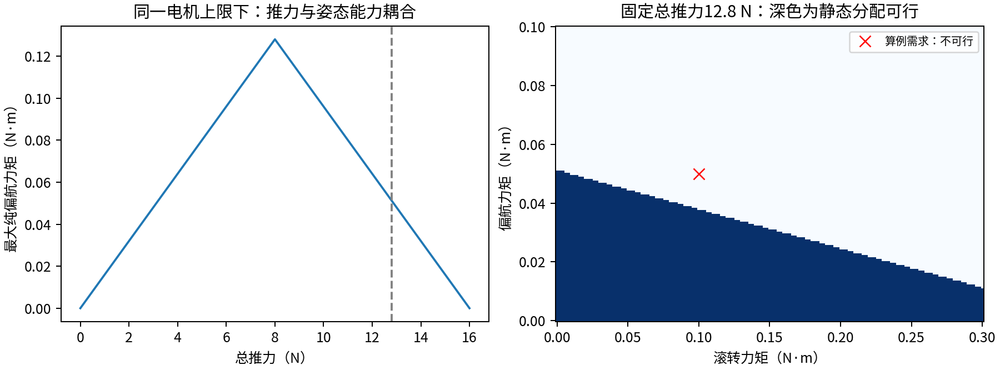
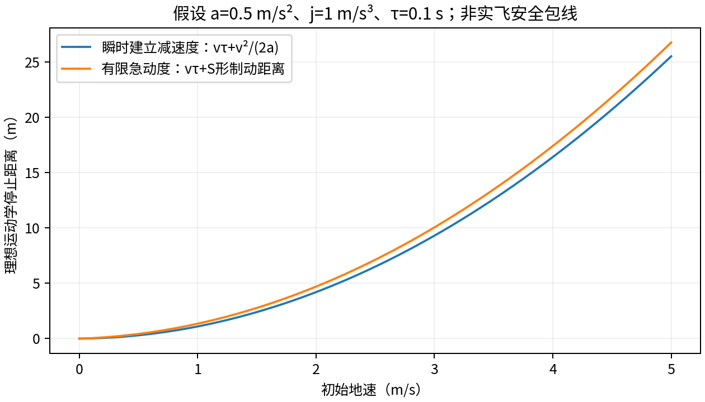
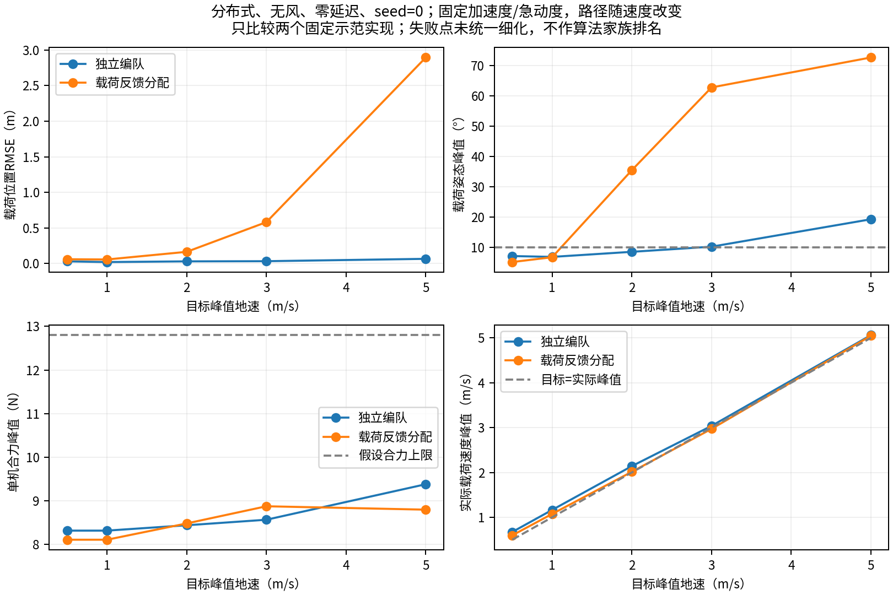
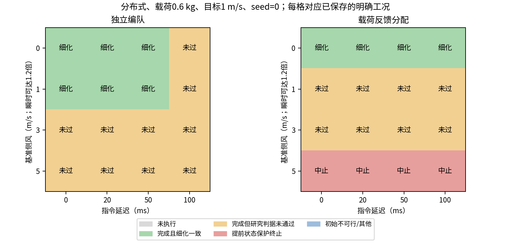
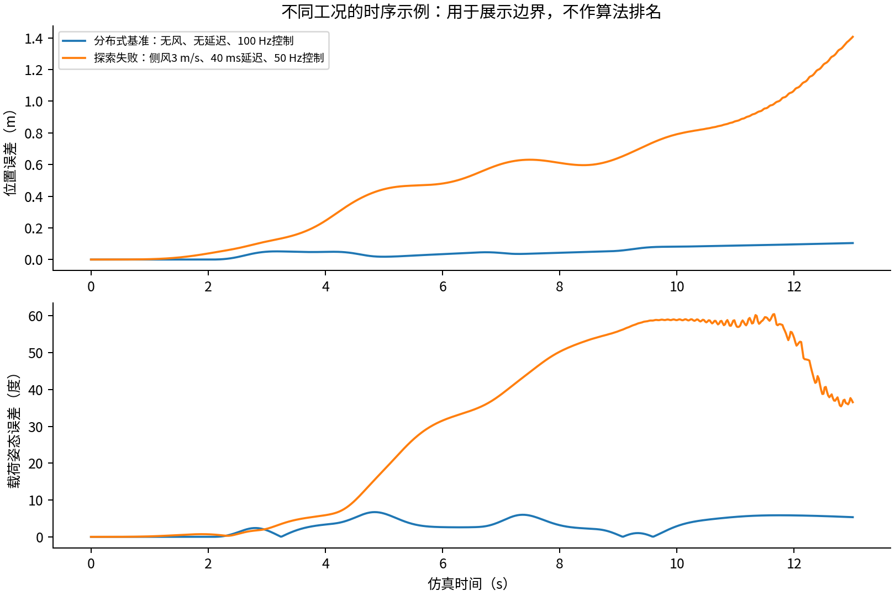

# 本轮实际完成范围

原报告17页、24项资料保留不变。本轮新增原始来源与独立审查专题、可运行的三维耦合简化模型，以及逐工况保存的研究参数扫描。当前读取到**620条本版本记录**，其中564条完成了预定时间积分。候选工况的细步长复核另行记录。

**本报告没有给出真实机型的安全最高速度。**模型参数含明确假设，且省略无人机自身姿态和单旋翼分配。这里的“研究判据满足”只针对所定义的模型与阈值；不等同于实飞安全、制造商额定性能或法规认证。

执行截止：2026年11月1日06:00 UTC+8。当前模型SHA-256前16位：`9e8dd1181dc27cb6`，完整值见RUN_MANIFEST.json。其他模型版本记录数：0；不混入本版本的比较。

# 截止汇总：完成范围、证据类别与仍未解决的问题

研究截止为**2026年11月1日06:00 UTC+8（10月31日22:00 UTC）**。实验状态已关闭；最后工况在截止前启动，截止检查后中止并落盘，关闭时间为22:00:00.122 UTC。两个后台进程均已退出。截止后只汇总、导出和核验已存在的成果，没有新开研究或仿真。

## 最终计算记录

| 已保存记录类别 | 数量 | 应如何解释 |
|---|---:|---|
| 完成预定时间积分 | 564 | 其中328满足当前研究判据并细化一致，236未满足 |
| 提前状态保护终止 | 47 | 保留终止前数据，不用截短RMSE冒充完整任务表现 |
| 初始研究约束不可行 | 8 | 没有进行该工况时间积分 |
| 截止中止 | 1 | 运行至约19.6/21.0 s，未完成，不授予通过 |
| 合计 | 620 | 不等于620次实物试飞 |

去除无风不同seed的确定性重复后，共384组配置，包含未积分或截断配置；仍不能据此估计真实事故概率。7356组预定队列中6736组尚无提交记录：双因素尚缺160组，大factorial组6576组全部未运行。05:03专题的499条固定快照保留用于复现，其统计不是本表的最终统计。

已核对620条配置/哈希/判据、最终CSV与状态，并检查612份批量时序的列数、有限数值、时间单调性及结束时间；本次一致性检查未发现违例。模型SHA与启动版本相同，原17页报告及其登记文件的校验和未改变。检查结果不等于完整物理模型的正确性证明。

## 证据分层及原始入口

原报告24项资料、夜间18组核查材料均保留读取范围；夜间登记包含对旧论文的深入核验，**不能合计成42篇不同论文**。

| 证据类别 | 本轮已有材料举例 | 支持的结论及限制 |
|---|---|---|
| 厂商规格、手册或台架记录 | DJI FlyCart、ALTA X、Bitcraze、T-MOTOR | 支持对应配置的质量、载荷、模式或台架数据；单机产品不等于多机联合系统 |
| 原始论文实体实验 | RSS 2013；Sun等2025；Wahba与Hönig2024；Li与Loianno2023 | 证明各自系统可运行；保留定位、机动和硬件条件，不拼成通用速度包线 |
| 原始论文仿真或理论 | Lee2014；Sun与Franchi2023；弹性绳理论 | 用于模型、算法与假设核查，不能写成该文已实飞 |
| 本轮已执行仿真 | 620条已保存简化模型记录 | 检查特定实现及假设下的耦合现象；不是文献算法完整复现 |
| 解析和独立数值算例 | 静力、分配可行域、S形制动、冲量投影 | 可复算必要关系或孤立事件；不是实飞速度/冲击认证 |
| 未验证假设和软件配置 | B0、12.8 N规划上限、绳刚度/阻尼、气动面积、软件限幅 | 必须辨识或单独验证，不能升级成持续或峰值硬件额定能力 |

主要原始入口：[DJI规格](https://www.dji.com/flycart-30/specs)、[ALTA X官方性能表](https://docs.freeflysystems.com/products/products/alta-x/untitled-3/performance-specs)、[RSS2013原文](https://roboticsproceedings.org/rss09/p11.pdf)、[Sun等2025全文](https://arxiv.org/html/2501.18802v2)、[几何控制与QP作者稿](https://arxiv.org/abs/2304.02359v2)、[载荷NMPC作者稿](https://arxiv.org/abs/2303.06165v2)、[载荷—绳方向NMPC作者稿](https://arxiv.org/abs/2301.08545v4)、[Brushless辨识作者稿](https://arxiv.org/abs/2603.05944)。完整书目信息及其他来源见原报告和四个专题。

## 主要任务的最终判断

**载荷与含电池机体质量增大，会压缩推重比和动力余量，但不能唯一决定安全飞行速度。**安全包线还取决于逐机/逐旋翼力与力矩、可用持续功率、电压与温度、空速和风向、路径曲率、加速度/急动度、制动空间、绳索状态及测量与执行延迟。

厂商最高推力、软件上限、论文控制参考上限与任务持续可用推力必须分开。本轮没有把DJI最大载荷反推成确定推力，也未把ALTA X资料冲突行用于推荐起飞配置；T-MOTOR异常行保留并排除，不擅改小数点。B0的0.6 kg每机含电池口径、0.6 kg载荷、1 m绳、20°、1 m/s初值，仍是一套研究假设，而非实机参数认证。

总推力余量也不能替代控制分配。独立假设算例中，总请求12.8 N低于16 N标量总上限，叠加姿态力矩仍使单旋翼请求达到4.189 N，超过其4 N上限。另在本轮1.8 kg载荷仿真中，一条满足研究判据的记录仍几乎触及合力上限，约6.85%采样发生指令裁剪；原判据没有要求剩余动力余量或裁剪为零。

空速应用矢量关系计算，不能把所有方向的风速直接与地速相加。制动需考虑急动度：在假设净减速度0.5 m/s²、急动度1 m/s³、延迟0.1 s时，5 m/s的理想停止距离为26.75 m，较瞬时建立减速度公式的25.5 m更长。该算例尚未包括绳摆、阵风和跟踪误差，不能把26.75 m当成真实保证距离。

## 高级算法、挂点与失败结果的判断

原始证据支持几何控制与约束分配、NMPC、全系统规划与INDI，以及鲁棒/自适应等不同架构在相应平台上的用途；不能只按名称排名。夜间进一步核查了绳力上限与旋翼推力上限的区别、软路径约束、计算/通信时限及状态估计成本。当前两个示范控制器都用理想状态和精确绳力前馈，不能替代这些论文的统一实机比较。

共点挂载缺少独立载荷全姿态力矩；非共线分布式挂点可增加三维绳力映射的力矩能力，但当前固定绳方向下三个标量张力仍只有最多三个独立输入。固定绳角比较时两者初始机间距不同，等机间距只完成了静态核查，未冒称完成该组动态对照。

全部失败与截断数据保留。无风seed重复不增加独立样本；质心共点零姿态误差不等于主动抗姿态扰动；初始绳方向偏差不等于任务参考跟踪误差。30°转向组的指标适用范围诊断保留旧False标签，没有改标为安全通过。粗步长能量检查最初失败及细化过程也保留。

## 未完成内容与资料包范围

尚未取得目标实机全套含电池质量/惯量、低电压持续与峰值动力/力矩包线、实际气动、低张力绳材/接头和端到端信息误差辨识；没有完整无人机姿态/单电机闭环、故障降落、地面起吊接触、硬绳重新绷紧混合模型的联合验证；没有运行新的NMPC或INDI联合吊运实验，也没有完成原计划全部参数网格或真实室外试飞。

资料包更新包含原报告及其参数、解析代码和数据，夜间报告PDF/Word/Markdown、模型与启动快照、全部620条标量记录、612份已保存批量时序及既有探索时序、CSV、图、日志和核查记录。时序仅含已定义的19列，不能还原未保存的完整40维状态或绳方向。第三方论文全文不随资料包重新分发，提供原始链接、读取范围和已有下载清单。

**本轮成果可用于搭建和核对下一阶段研究，尚未获得真机安全认证、通用安全速度或完整算法优劣结论。**

终稿导出时间：2026-11-01 06:10:15 UTC+8。截止之后只进行既有材料汇总、导出与一致性核验。

# 一、主要任务的证据补强

# 夜间专题一：把假设参数收敛到可辨识、可复现的输入

本专题补充原报告的主要任务，不替代具体机型的参数辨识。资料核查日期为2026年10月31日UTC；本文以N编号引用新增来源。原报告R编号继续有效。

## 1. 质量、推力与软件上限必须属于同一配置

2026年的Crazyflie Brushless建模论文给出了比产品页更完整的实验配置：带保护罩质量44 g、不带保护罩40 g，对应惯量分别为diag(3.3,3.6,5.9)×10⁻⁵和diag(1.8,2.4,3.0)×10⁻⁵ kg·m²；电机转速模型时间常数50 ms。[N1，Table II] 这些质量与产品页的34/37 g并不矛盾，附加板卡和定位附件不同，不能互换分母。

N1的单电机推力拟合采用归一化转速r=Ω/2900，T(r)=−0.23r³+0.562r²−0.043r，单位N。在r=1处为0.289 N，四机合计1.156 N；按44 g配置的无外载推重比约2.68，若再加40 g载荷则约1.40。[C：仅基于该模型和该转速；没有证明它是持续保证上限。] 多项式在很低转速区可能给出负值，因此需要保留拟合适用范围，不能把局部拟合无条件外推到停转状态。

另外一个实飞辨识基准采用45 g整机，正文给出惯量diag(2.3951,2.3951,3.2347)×10⁻⁵ kg·m²，并说明来自Crazyflow参数，而非本篇独立测得全部惯量。[N2，Section 4.1] 这说明“论文采用的数值”还应继续追踪其辨识来源。

当前下载的Crazyflow提交`dbf84eaa7780`中（完整提交号见固定版本链接），`cf21B_500`的质量为43.4 g，`thrust_max=0.2`注明为每电机N，其软件总上限0.8 N对应无外载比值约1.88。[N3] 这个软件工作上限不能与厂商最高标称推力或N1在特定转速下的模型输出混为一谈；文件中部分系数也带TODO注释，必须保留。不能因其位于开源仓库就视为所有参数已获硬件验证。

**对原报告的改进：**如果需要尽量减少占位参数，可另建立“44 g实验配置”的微型平台组，并整套采用N1的质量、惯量、转速模型、推力/力矩拟合与延迟条件。仍不能把该单机模型自动当作联合吊运已验证模型。

## 2. 电压补偿不等于最大推力不随电量变化

Bitcraze官方文档明确给出了基于推力台数据和电池电压的补偿流程，并有静态与动态辨识示例。[N4] 它支持“应建立电压相关的指令—实际推力映射”，不支持“补偿能恢复任意低电量下的满电最大推力”。当PWM、电流或温度饱和时，补偿没有额外能量可用。[C：执行器限制的物理推论。]

建议把两个函数分开：

- 可用能力：Tmax(V、温度、空气密度、任务持续时间)。
- 指令映射：u=Φ(Tcmd、V)，并受电流、转速和PWM限制。

只有同时知道二者，才能判断同一载荷在低电量时是否仍有足够机动余量。原报告κ=0.8继续保留为A类敏感性假设；本轮没有找到足以把它变成所有0.6 kg平台通用实测值的证据。

N1的50 ms是**转速模型**时间常数；夜间简化仿真的40 ms是**合力向量响应**假设。两者不是同一状态，不应直接等号替换。即使T=kΩ²，转速一阶响应经过平方后，大幅阶跃的推力也不是同一个时间常数的一阶响应。[C]

## 3. 市售电机台架表给出的可核查功率代价

T-MOTOR MN4014 KV400、22.2 V、15×5 CF桨的官网表提供如下原始记录。[N5，E1] 保留油门口径，不能将油门百分比解释为推力百分比。

| 油门 | 电流A | 电功率W | 推力gf | 转速rpm |
|---:|---:|---:|---:|---:|
| 50% | 5.7 | 126.54 | 1250 | 4500 |
| 65% | 9.1 | 202.02 | 1630 | 5200 |
| 75% | 12.0 | 266.40 | 1950 | 5800 |
| 85% | 15.8 | 350.76 | 2370 | 6400 |
| 100% | 18.7 | 415.14 | 2620 | 6700 |

从首末点看，推力增加到2.096倍，电功率增加到约3.281倍；这是载荷增加会更快侵蚀续航/热余量的具体实物佐证。它不是整机飞行功率曲线，也不含机间气动干扰。[C]

该页注明表中温度为100%油门运转10分钟后的电机表面温度；另有“180 s”最大功率/电流规格。不同功率、桨和时长不能混成一个无限持续能力。[N5]

**发现并保留的异常：**17×5.8 CF桨85%行列出2.17 A、48.17 W、3110 gf、64.56 gf/W，而相邻75%/100%电流为16.7/25.7 A。该行P≈VI和推力/功率算术上仍互相一致，但物理趋势可疑；这说明仅检查乘法还不够。本专题将其排除出任何拟合，不擅自改成猜测的“21.7 A”。

此外，每个MN4014含线质量171 g，四个电机就有684 g。[N5] **不能把这组电机当作原报告0.6 kg整机的实际动力配置。**此表用于展示辨识方法与功率趋势，不作为B0的整机硬件清单。

## 4. 软件示例参数：可以复现，但不是额定保证

RotorTM固定提交`7c70274c0017`中（完整提交号见固定版本链接）：[N6]

- Hummingbird示例为0.5 kg，惯量(0.00264,0.00264,0.00496) kg·m²；最高转速7500 rpm，四桨系数5.55×10⁻⁸。
- Snapdragonfly示例为0.25 kg，惯量(0.000601,0.000589,0.001076) kg·m²；最高转速16400 rpm，系数3.9408732×10⁻⁹，YAML注明N/rpm²。
- `3_robots_triangular_payload_1m.yaml`引用的是三个Snapdragonfly，并非Hummingbird；载荷文件质量0.278 kg，绳长均1 m。

按代码的maxF=桨数×系数×最高转速²，Snapdragonfly示例单机上限约4.240 N，三机与0.278 kg载荷的总量推重比约1.261。[C：软件示例定义下的换算。] 该读参文件的旧注释却写“gramf/rpm²”，与YAML的N/rpm²及动力学N量纲不一致。复用时应核查实际公式和单位，不只复制注释。

本轮没有启动ROS/RotorTM，也没有证明其当前控制链一定对每个工况执行上述上限。参数“在示例中出现”、参数“经过辨识”、参数“作为运行时约束执行”应分别核对。

## 5. 绳索材料证据：强度、刚度和阻尼不能相互替代

LIROS DC Pro 201官网列出约1.10 mm直径、200 daN破断强度，即2000 N。[N7] 这不是允许工作载荷，也没有直接提供2–10 N低载张力区间的切线刚度或阻尼。页面的“Strain fracture load 3.70”没有清晰展示单位，不能据此直接算杨氏模量。

Samson AmSteel-Blue官网提供在破断强度10%/20%/30%处的弹性伸长0.46%/0.70%/0.96%；2.5 mm规格质量约0.45 kg/100 m。[N8] 由这类负荷—应变数据，在指定工作点可以计算割线刚度ksec=F/(εl)，但不能把高负荷比例下的割线值直接外推到几牛顿工作点。编织压实、预拉伸、接头和加载历史都可能改变有效刚度。

因此夜间模型k=1000 N/m、c=1 N·s/m仍是A类建模假设，不能声称代表任意Dyneema细绳。若采用3根1 m、2.5 mm该规格绳，绳质量合计约13.5 g：对2.4 kg B0约0.56%，对三机43.4 g加40 g载荷的微型系统则约7.9%。[C] 同样的无质量绳假设，在两个尺度上的误差地位完全不同；这里没有推荐给微型机使用这种偏重绳材。

高刚度会产生更快的轴向模态。若把弹性绳当成不可伸长绳，应采用受约束/混合动态模型或证明刚性极限下的近似条件；不能只把k设得很大而不检查数值稳定性。弹性吊运的几何控制已有理论研究，但其奇异摄动结果有条件，不等于任意刚度、阻尼、初始误差都可直接替换。[N9]

## 6. 建议执行的参数辨识程序

1. 称量完整飞行配置并记录电池、保护罩、定位板和绳端件；测量质心与挂点坐标。
2. 在任务覆盖的电压、温度和转速区间测静态推力/反扭矩；记录电流、电压、持续时间与温度。先拟合可行域内模型，保留独立验证数据，检查负推力和非物理外推。
3. 对转速进行阶跃/扫频辨识，区分上升与下降响应；不要把PWM、RPM、推力三个状态混为一个时间常数。
4. 通过CAD、摆锤或可控角加速度实验辨识惯量；非对角项和挂点偏置变化较大时保留完整矩阵。
5. 对实际绳+接头在工作张力范围测往返拉伸和衰减，分别识别刚度、滞回/阻尼和绳端滑移。
6. 用未参与辨识的平移、偏航和带载动作做多步预测验证，而不是只报拟合曲线R²。N2提供了多预测窗口评估和数据同步的可参考范式。
7. 将辨识不确定区间带入规划约束收紧、抗扰分析和敏感性试验；不能仅凭一个最佳拟合值宣布速度安全。

以上是研究设计建议，不是要求使用者直接进行危险的高油门自由飞行测试。推力台、保护装置和具体试验流程应与目标硬件匹配。

## 新增原始来源

- **N1** Gräfe, A.; Scherer, C.; Hönig, W.; Trimpe, S. *How to Model Your Crazyflie Brushless*. arXiv:2603.05944, 2026。已读全文，Table II、Section IV–V。[原文](https://arxiv.org/abs/2603.05944)。
- **N2** Busetto, R.等. *Nonlinear System Identification Nano-drone Benchmark*. arXiv:2512.14450, 2025；关联Control Engineering Practice DOI 10.1016/j.conengprac.2026.106871。已读作者稿全文，Section 4–6。[全文](https://arxiv.org/html/2512.14450v1)。
- **N3** learnsyslab. *Crazyflow first-principles parameters*, commit `dbf84eaa7780`（完整提交号见链接）。已读参数文件；未运行软件。[固定版本原始文件](https://github.com/learnsyslab/crazyflow/blob/dbf84eaa77808669254d914998ec139d3f4a425a/crazyflow/dynamics/first_principles/params.toml)。
- **N4** Bitcraze. *Battery Compensation*，官方文档及2025-10-20辨识说明。[原始文档](https://www.bitcraze.io/documentation/repository/crazyflie-firmware/master/functional-areas/battery_compensation/)；[作者说明](https://www.bitcraze.io/2025/10/keeping-thrust-consistent-as-the-battery-drains/)。
- **N5** T-MOTOR. *MN4014 KV400*，MN.00025及Test Data。已核对原始官网表，保留异常行。[官方表](https://store.tmotor.com/product/mn4014-kv400-motor-navigator-type.html)。
- **N6** arplaboratory. *RotorTM*, commit `7c70274c0017`（完整提交号见链接）。已读YAML、读参公式与动力学部分。[固定提交](https://github.com/arplaboratory/RotorTM/tree/7c70274c00174708b65cd518267c73d9c5abea99)。
- **N7** LIROS. *DC Pro 201*及Technical Information。官网规格；未将破断强度当作工作载荷。[产品](https://www.liros.com/catalog/en/dc-pro-201-p2043/)；[技术口径](https://www.liros.com/catalog/en/support/technical-info/)。
- **N8** Samson. *AmSteel-Blue*，Elastic Elongation及Specifications。官网规格。[原始页面](https://www.samsonrope.com/mooring/amsteel--blue)。
- **N9** Goodman, J.; Colombo, L. *Geometric Control of Two Quadrotors Carrying a Rigid Rod with Elastic Cables*. Journal of Nonlinear Science 32, 65, 2022. DOI 10.1007/s00332-022-09821-w。使用原始摘要的理论适用范围，不提取未核实实验参数。[期刊](https://link.springer.com/article/10.1007/s00332-022-09821-w)。

# 夜间专题二：控制分配、姿态能力与松绳冲量的独立复核

本专题由UTC+8约03:04开始的检查点新增。它不修改运行中的三机弹性绳模型；所有独立算例与输出位于`allocation_and_impact_audit.py`及`checkpoint_03_independent_audit.json`。尺寸、电机上限、力矩系数与速率限制是A类假设，计算结果为C类，不能作为真实机型性能。

## 1. 为什么总推力上限仍不够

真实四旋翼通常要同时产生总推力及三轴姿态力矩。设各旋翼推力为$f_j$，机体坐标下旋翼位置为$(x_j,y_j,0)$，桨旋向为$\sigma_j$，反扭矩/推力比为$\gamma$，则静态映射可写成

$$
\begin{bmatrix}F\\\tau_x\\\tau_y\\\tau_z\end{bmatrix}
=Bf,\qquad
B=\begin{bmatrix}
1&1&1&1\\
y_1&y_2&y_3&y_4\\
-x_1&-x_2&-x_3&-x_4\\
\gamma\sigma_1&\gamma\sigma_2&\gamma\sigma_3&\gamma\sigma_4
\end{bmatrix}.
$$

正确的可行性条件是存在满足各旋翼上下限的$f$，使$Bf$等于所需广义力；若考虑动态，还需满足转速/推力变化限制。单独检查$F\leq\sum_j f_{j,\max}$只是必要条件。若$\gamma$随工作点变化，固定线性矩阵也只是近似；已有原始工作采用迭代混合处理这种变化。[A2]

PX4官方文档也明确区分姿态/角速度控制器与控制分配模块：前者给出期望力矩和推力，后者按构型转为执行器指令。[A3] 因此在上层实现几何控制、MPC或INDI，都不能跳过执行器分配。

## 2. 一个可以独立复算的反例

假设X形四旋翼：质心到电机距离0.17 m，横/纵坐标绝对值$a=0.17/\sqrt2=0.120208$ m；每电机上限4 N；$\gamma=0.016$ m，旋向交替。请求

$$F=12.8\ \mathrm N,\qquad (\tau_x,\tau_y,\tau_z)=(0.10,0,0.05)\ \mathrm{N\,m}.$$

总推力仅占16 N物理标量上限的80%，但精确解得四个电机推力约为

$$f=(4.1892,\ 2.6267,\ 3.7733,\ 2.2108)\ \mathrm N.$$

第一个电机已经超过4 N，故该广义力不可行。**保留20%的总推力余量，不足以保证任意同时请求的姿态力矩都可实现。**这不是说20%在所有任务中不够，而是说明余量还必须结合任务所需力矩和控制分配检查。

若保持滚转/俯仰力矩为零，该理想X形布局的纯偏航能力为

$$|\tau_z|\leq\gamma\min(F,16-F).$$

在$F=12.8$ N时，纯偏航力矩上限为0.0512 N·m；同时增加滚转需求还会进一步缩小可行域。相同电机和桨，载荷越重通常需要越大的平均推力，也可能压缩姿态控制能力。这补充了原报告中“推重比下降”的含义。

若把反例中超过上限的电机直接截为4 N，其实际广义力约为$(12.6108,0.07725,0.02275,0.04697)$，不仅少了总推力，也同时改变了滚转和俯仰力矩。可见逐电机简单截断不是保持期望姿态控制的办法。[C]

本专题还做了一个示范加权有界最小二乘分配。先按力/力矩量纲归一化，再对总推力、滚转、俯仰、偏航采用权重10/100/100/1，得到约$(12.7709,0.099991,0.00000875,0.038358)$。它主要牺牲偏航，较好保留滚转/俯仰，但这个有限权重例子既不是严格字典序优化，也不是对某篇论文的完整复现或闭环稳定性证明。[C]

## 3. 原始实体研究怎样处理饱和

Smeur等在INDI控制框架中加入加权最小二乘分配，使用Parrot Bebop 1和Paparazzi做实体试验，讨论滚转/俯仰优先、其次总推力、最后偏航的取舍。[A1] 这说明抗扰控制本身并不能消除执行器饱和。其软件设置的RPM上限还低于接口名义可接受上限，不能把“接口允许发送的数值”直接当作可用动力能力。

Faessler等的原始论文给出了单机实体试验、LQR角速度控制、迭代推力混合和饱和优先级处理，并在台架上区分上升/下降响应时间常数11/27 ms。[A2] 这些是该硬件条件下的数值，不能移作B0默认参数；也不能将其单机高速轨迹试验写成带载联合吊运实飞。

这种局部优先级有明确适用场景。联合吊运若载荷偏航本来就是任务约束，还需由上层规划、编队和张力分配协调，不能把“无人机局部yaw优先级较低”误解为“载荷yaw不重要”。

PX4的状态消息进一步区分“执行器到达上下限”“执行器变化速度受限”和“推力/力矩指令未实现”。到达边界本身不一定意味着期望广义力未实现，尤其在有冗余执行器时；应同时记录未分配推力和未分配力矩。[A4]

## 4. 对原仿真初值和挂点的具体影响

如果无人机端挂点相对自身质心为$b_i$，需要在机体姿态方程加入

$$\tau_{c,i}=b_i\times(-R_i^T t_i u_i).$$

静态悬停可出现非零绳索力矩；此时仅输入正确总推力和机体倾角，而不给电机提供反向姿态力矩，并不构成真实四旋翼平衡。载荷机动时，还需叠加$J_i\dot\omega_i+\omega_i\times J_i\omega_i$等姿态需求。

现有后台模型把无人机当作质点，使用一阶合力向量响应，没有单电机分配。因此其“force≤12.8 N且倾角≤25°”结果不能自动证明真实四旋翼可执行。同样，把挂点移到机体下方0.03 m不应只改变几何位置，必须同步修改姿态动力学与初始化。这是模型层级限制，不是本轮发现了正在运行模型宣称范围内的核心力学错误。

还要区分能力速率。独立算例假定每电机推力变化上限20 N/s、控制周期10 ms。从总推力7.8804 N均匀分担，立即要求9 N时，各电机需从约1.9701 N变到2.25 N，至少需要约14.0 ms；静态可行不代表一个控制周期内可完成。[C、A] 这里的推力速率不是N1论文中的转速时间常数，不能互换。

## 5. 弹性受拉绳模型的能量审查

设伸长$e=d-l_0$、轴向相对速度$r=\dot e$，后台模型在$e>0$时取$t=\max(0,ke+cr)$，否则$t=0$。弹性势能为$U=\tfrac12k\max(e,0)^2$。

内部绳索力对整个系统的机械功率为$-tr$。因此在激活且未截断时

$$\dot E_{\mathrm{cable}}=(ke-t)r=-cr^2\leq0.$$

对于$k>0,c>0$，若激活但$ke+cr\leq0$而张力被截为零，则$r\leq-ke/c<0$，有$\dot E_{\mathrm{cable}}=ker\leq0$。若$c=0$，拉伸区恒有$t=ke$，内部连接保守；松弛区绳索力与势能均为零。因此这个受拉弹性模型在连续时间上不会凭空由内部连接增加机械能。[C；不含外力和执行器做功。]

这个推导支持其作为一种耗散软绳模型，但不能证明任何积分步长都精确保能，也不能代替真实绳材、阻尼和接头的辨识。切换点会降低光滑性，所以原先粗步长能量误差仍必须保留和细化。

## 6. 不可伸长绳重新绷紧：冲量模型是另一层问题

若采用不可伸长绳，松绳重新拉紧时不能只强制长度回到$l$、却保留原来的向外相对速度。RotorTM原始论文与代码显式处理了这类瞬时速度改变，且刚体载荷还涉及角动量。[A5]

以广义速度$v$和质量矩阵$M$表示系统，$Jv$为新激活绳索的轴向相对速度。若采用完全非弹性、无外部瞬时冲量、给定有效激活集，速度投影可写为

$$\Lambda=(JM^{-1}J^T)^{-1}Jv^-,\qquad v^+=v^- - M^{-1}J^T\Lambda.$$

该式要求所取激活集给出的绳索冲量非负。若某分量为负，应重新求单边约束的有效集/互补问题，不能简单把它截为零后仍声称满足同一个速度投影。接近奇异构型时还需检查秩与数值条件。

独立三绳算例采用0.6 kg载荷、每机0.6 kg、与B0一致的三挂点和20°绳向，各无人机初始沿各自绳方向以0.2 m/s向外运动。投影后各根轴向相对速度残差约10⁻¹⁷ m/s，线/角动量变化在浮点误差量级；动能从0.0360 J降到约0.0261345 J。[C] 这只是孤立瞬时事件的核查，**没有装入正在运行的弹性绳模型**。

两个0.6 kg质点的简单交叉核查：绳轴速度初始为1和0 m/s，完全非弹性拉紧后均为0.5 m/s，冲量0.3 N·s，动能损失0.15 J。[C] 若原本沿绳方向相互接近，则不应施加“防止继续分离”的拉紧冲量。

## 7. 对当前数据和比较方式的审查

截至独立审查快照19:08 UTC，已读取117条已提交记录，模型源码SHA与启动清单一致；未发现负张力记录或细步长一致性标记前后矛盾。未改动正在运行的模型与队列。

另发现：本轮seed只改变风的正弦相位，因此在风为零时，seed=0/1是确定性重复，不是两个独立不确定性样本。已检测到54组此类重复，其示例位置RMSE完全一致。它们可以用于重复性检查，但不能增加独立样本量、构造事故率或可靠性置信区间。

时间积分“完成”只指跑到预定仿真时刻，不代表通过判据；`divergence_or_state_guard`是提前终止，应另列发生时刻和终止前偏差，不能把它从失败记录中消失。后续报告必须同时显示完整积分未通过、提前终止、初始约束不可行和实现异常，而不是仅展示成功点。

本轮没有确认需要中断后台实验的核心物理错误；继续保留该模型作为有明确省略项的探索性参数扫描。单电机分配、机体姿态、绳材辨识和严格冲量模型仍是升级完整飞控仿真前的实质工作。

## 新增原始参考资料

- **A1** Smeur, E.J.J.; Höppener, D.C.; De Wagter, C. *Prioritized Control Allocation for Quadrotors Subject to Saturation*. IMAV 2017, pp.37–43. 已读全文；实体INDI/WLS试验的用途与限制见正文。[会议原文](https://www.imavs.org/papers/2017/6.pdf)。
- **A2** Faessler, M.; Falanga, D.; Scaramuzza, D. *Thrust Mixing, Saturation, and Body-Rate Control for Accurate Aggressive Quadrotor Flight*. IEEE Robotics and Automation Letters, 2(2), 2017, pp.476–482. DOI:10.1109/LRA.2016.2640362。已读全文，不将单机实飞外推为多机带载实飞。[作者原文](https://www.ifi.uzh.ch/dam/jcr%3A5f3668fe-1d4e-4c2b-a190-8f5608f40cf3/RAL17_Faessler.pdf)。
- **A3** PX4. *Control Allocation (Mixing)*，main文档，核查日期2026-10-31；仅用于软件控制链说明。[官方文档](https://docs.px4.io/main/en/concept/control_allocation)。
- **A4** PX4. *ControlAllocatorStatus*，main消息定义，核查日期2026-10-31。[官方消息文档](https://docs.px4.io/main/en/msg_docs/ControlAllocatorStatus)。
- **A5** Li, G.; Liu, X.; Loianno, G. *RotorTM*, T-RO 2024，DOI:10.1109/TRO.2023.3336320。本轮进一步读取全文冲量/角动量段及固定提交的`ptmass_inelastic_cable_collision`函数；独立算例为本文推导，不声称逐行复现其一般混合求解器。[作者稿](https://arxiv.org/abs/2205.05140)；[固定版本代码](https://github.com/arplaboratory/RotorTM/blob/7c70274c00174708b65cd518267c73d9c5abea99/rotor_tm_sim/src/rotor_tm_sim/simulation_base.py)。

# 夜间专题三：有限急动度制动、风向与高级控制架构的证据复核

本专题先补充主要任务的速度与制动空间，再深入比较控制层级。所有新增计算由`simulation/braking_and_wind_audit.py`实际执行，标量与核查记录已保存。A表示假设，C表示计算；原始报告的厂商/论文证据分类继续有效。本轮未改动运行中的耦合模型和队列。

## 1. 有限急动度会改变制动空间

原报告的$v\tau+v^2/(2a)$适合解释反应延迟和恒定减速度，但它假设延迟结束后能立即建立减速度。若还限制急动度$j$，并要求制动前后加速度为零，理想一维、单调减速、无其他约束的最短时间制动采用对称S形加速度。记初始**地速**为$v\geq0$，减速度上限$a>0$，急动度上限$j>0$，则

$$
T_b=\begin{cases}
2\sqrt{v/j},&v\leq a^2/j,\\
v/a+a/j,&v\geq a^2/j,
\end{cases}\qquad d_b=\frac{vT_b}{2}.
$$

低速时减速度呈三角形，峰值为$\sqrt{vj}$，尚未达到$a$；高速时含恒定减速度段。两式在$v=a^2/j$连续。[C，分段积分推导；不是从某一实机拟合。]

若延迟期间维持匀速，停止距离为$d=v\tau+d_b$。在高速分支，它比瞬时建立减速度的公式多出$va/(2j)$。这里的$a$是给定且假定可跟踪的**净运动学减速度**，并不是由总推重比直接得到的可用减速度。

采用A类输入$a=0.5\ \mathrm{m/s^2}$、$j=1\ \mathrm{m/s^3}$、$\tau=0.1$ s，得到：

| 初始地速(m/s) | 瞬时减速度公式(m) | 有限急动度公式(m) | 制动段时间(s，不含延迟) |
|---:|---:|---:|---:|
| 0.5 | 0.300 | 0.425 | 1.5 |
| 1 | 1.100 | 1.350 | 2.5 |
| 2 | 4.200 | 4.700 | 4.5 |
| 3 | 9.300 | 10.050 | 6.5 |
| 5 | 25.500 | 26.750 | 10.5 |

若再人为预留0.5 m距离，反解3/10/30 m总空间，分别得到约1.416/2.912/5.259 m/s的**假设运动学速度**。[A、C] 这些值用于检查轨迹/场地尺寸是否自洽，不能直接作为飞行限速。若发出制动时还在向前加速，延迟期间继续加速，或存在阵风、状态误差、绳摆及执行器饱和，上述模型均不能给出保守保证。不能把0.5 m占位余量称作已验证的安全距离。

独立代码逐段多项式传播并数值积分速度，检查终端速度和加速度为零；最大距离差约$2.22\times10^{-16}$ m。另与后台已有七段`Motion`参考的加速/制动距离交叉核查，7个表列速度全部一致。这验证的是参考轨迹计算，没有验证载荷能精确跟踪该制动参考。

## 2. 相同地速，风向会改变空速和可用加减速

以相对空气的速度$\mathbf v_a=\mathbf v_g-\mathbf w$计算阻力：

$$\mathbf D=-\tfrac12\rho C_DA\|\mathbf v_a\|\mathbf v_a.$$

同为沿$x$方向3 m/s地速，无风、同向3 m/s风、反向3 m/s风和侧向3 m/s风，对应空速分别为3、0、6和$\sqrt{18}\approx4.243$ m/s。不能用“地速3加风速3”替代所有方向的矢量计算。侧风还消耗侧向推力和倾角，未必表现为沿航向的阻力增加。

为与B0的量级一致，独立算例假定三机和载荷共速、总质量2.4 kg、总$C_DA=0.15$ m²、$\rho=1.225$ kg/m³。后三个气动数值均为A类输入，不是厂商辨识值。匀速时，上述四种情况的合阻力大小分别为0.8269、0、3.3075、1.6538 N；侧风情况下其$x/y$分量约为$(-1.1694,+1.1694)$ N。[C]

全系统外力平衡要求

$$\mathbf F_{\Sigma}=M\mathbf a-M\mathbf g-\mathbf D.$$

反向3 m/s风中，若地面参考要求沿$x$减速度$-0.5$ m/s²，阻力为$-3.3075$ N，而$Ma_x=-1.2$ N，此刻合旋翼力的$x$分量仍需约$+2.1075$ N。即“向前倾就一定在加速、刹车就必须向后倾”都不普遍成立。所需净减速度由旋翼、气动与绳索耦合共同形成，不能从姿态符号单独判断。

这些只是瞬时合力必要关系。即使合力范数和合倾角满足某一上限，各机张力、姿态力矩、电机分配、动力延迟、功率与电池电压仍可能不允许实现；专题二已给出单电机超限反例。恒定风快照也没有证明整个停止过程满足约束。完整12行计算见`wind_ground_airspeed_force.csv`。

## 3. 载荷NMPC：计算轻，但绳力不是瞬时可实现的执行器

本轮下载并核读Li与Loianno的IROS 2023作者稿v2主要模型、控制和实验章节，深化原R14证据。[B2]

其预测状态只含载荷位置、四元数、线速度和角速度，共13个标量；输入由载荷广义力与绳力分配零空间系数组成。若挂点映射$P$满行秩，输入维数为$6+(3n-6)=3n$。原文把状态和输入合计写作$13+3n$；它不是单独“状态维数”。[式(15)、(21)]

预测绳力决定期望绳方向和几何无人机位置，用于机间距与障碍约束；下层再通过绳方向和无人机姿态控制去跟踪期望绳力。优点是较轻的优化、较简单的参考输入，并保留零空间构型调整；代价是预测中的绳力方向与实际绳方向之间存在跟踪过程。原文式(28)就把期望绳力投影到当前绳方向，不能将上层结果视作立即施加在载荷上的真实力。

尤其要核对原文式(26)：约束形式为$\|\mu_k\|\leq f_{\max}$，约束的是绳力模长。无人机自身还要抵消重力、产生平移与绳方向加速度，因此**绳力有上限并不足以单独保证旋翼总推力有上限**。简单静态反例：假设无人机0.6 kg、竖直绳张力2 N、假设旋翼合力上限6 N，虽有$2<6$，悬停仍需$5.886+2=7.886$ N。[A、C] 该反例不是复现原论文硬件，不否定其实体试验，而是限定这个不等式可支持的结论。

该文实体配置包括三机、232 g三角载荷、各1 m绳；使用100 Hz Vicon估计载荷与无人机里程计、再估计绳方向。圆参考半径1 m、周期15 s，因此参考切向速度约0.419 m/s、向心加速度约0.175 m/s²。[正文Section IV；速度/加速度为C] 这组工况不能写成高速或室外抗风验证。100 Hz是定位资料中明确的频率，不能据此推断NMPC也固定运行100 Hz；本轮未确认其求解最坏时延，不补造频率。

原文动力学式(3)显式含重力，而式(18)所列期望力为$m_L\ddot x_{L,des}$。实现时须核查其参考加速度、重力前馈与符号约定，并用悬停平衡检验，不能只逐字复制单式或在未读代码时断言实验实现错误。

## 4. 载荷—绳方向NMPC：动态更完整，仍不是单电机全模型

Sun与Franchi的ICUAS 2023作者稿v4本轮读取模型、约束、求解器、数值结果和讨论。[B1，新文献]

其预测状态包括载荷13维状态，以及每根绳方向、角速度和角加速度；输入是各绳角急动度和张力。它通过绷紧几何与无人机平移动力学重构无人机位置、速度、合推力、姿态和角速度参考。由此可直接在预测中约束各机合推力、绳张力及相关避碰几何，比仅把绳力作为载荷输入多描述了方向变化的带宽。

然而“完整非线性模型”需结合正文解读：该文讨论明确指出没有纳入每个执行器的限制，无人机姿态的期望角速度也不等于受力矩限制的电机动态已经被完整预测。更关键的是，正文将路径不等式实施为带松弛变量的**软约束**。名义求解得到小约束残差，不等于硬约束绝不违反；还需报告松弛量、物理跟踪误差与模型误差。其绷紧约束也只限定名义预测，不能代替专题二的实际松绳/冲击分析。

其示例为4架各1 kg无人机、4 kg载荷、4 m绳、挂点半径1 m；是**数值仿真**。文中最多10机的求解时间测试在笔记本上进行；不能称10机实飞，也不能把平均或中位求解时间当作最坏时间保证。文中“10 Hz已足够”的说法对应其数值参考轨迹跟踪方案，而直接发送合推力/姿态参考时又讨论更高更新率需求，不能脱离内环方案比较频率。

该文还明确：张力作为输入不要求直接测张力，但仍要求载荷和绳方向的完整状态，尤其绳方向角加速度。高阶导数的估计噪声与延迟是工程成本，不能用“不测张力”概括为“不需绳索或载荷状态传感”。该文结尾把实体验证列为未来工作。

## 5. 几何控制与QP分配：实体微控制器证据及其条件

Wahba与Hönig的RA-L 2024作者稿v2本轮进一步核读三层控制、QP构造、软件实现、实体表格及挑战部分，深化原R13。[B3]

其QP分配器替换几何控制中的伪逆分配，构造机器人对之间的分离超平面，减少求解成本。正文在阐述避碰关系时明确假设绳方向跟踪足够快、实际方向等于期望方向。因此分配出的无碰撞几何不自动成为有延迟、方向误差和尾流情况下的真实避碰保证。

实体平台为Crazyflie 2.1，正文所述平台质量34 g；该处没有逐项拆分电池和附件，不能自行把它当作另一电池配置的完整起飞称量，也不能与夜间专题一的44 g Brushless配置混用。STM32主控168 MHz、192 kB RAM；采用OSQP生成C代码、单精度、热启动，并将QP异步运行于控制环外。定位使用100 Hz OptiTrack；机器人和载荷状态通过广播发送。机载分布执行不代表无需全局状态或广播通信。若各机使用不同时间戳数据，独立求解器即便理论上有唯一解，也不能保证产生一致分配。

该文实体最多三机；质点figure-eight参考峰值0.5 m/s、刚体0.4 m/s。10机对应笔记本计算规模测试，须与三机实飞分开。其三机三角载荷配置为10 g、50 cm等长绳，单次飞行中QP总运行时间均值33.1 ms、标准差4.3 ms；正文称约30 Hz得到期望绳力。**均值33.1 ms不构成每33.3 ms内必定产生新分配的保证**；异步分配更新与快速控制环应分别记录，另查通信、状态估计、旧参考使用时间及截止时限遗漏率。文中还讨论约13 ms的QP设置开销；本报告不擅自再次把它加到表列33.1 ms上，以免在未核对计时定义时重复计算。论文表格明确是每种情形一次飞行的时间均值/标准差，不是多次独立实验置信区间。

最有实际价值的实现经验来自其挑战部分：测得的载荷加速度和期望绳方向导数过于嘈杂，作者分别使用参考加速度与零导数近似；增益随无人机数量、载荷类型敏感。这说明稳定性定理、名义方程和实体运行代码之间必须逐项核对。它也说明低推重比配置需要谨慎起飞、检查瞬态，不能用悬停有解替代控制性能。

## 6. 全系统规划与INDI：控制分配仍是底层边界

原R11的Sun等Science Robotics 2025资料进一步复核：中心规划在笔记本10 Hz运行，以WiFi发送参考，预测时域2 s；无人机运动捕捉100 Hz，载荷状态从无人机状态估计；机载INDI利用IMU补偿绳索力。[B4，对已有全文的深入读取]

它省去了载荷附加传感器，但没有省去无人机定位。低频规划与高频参考跟踪共同构成架构；不能只取10 Hz认定所有10 Hz外环都能实现相同机动。原文高速基线对比仍需保留“基线在仿真、提出方法另有实飞”的证据边界。专题二A1已提供INDI与优先级分配的单机实物证据；合力补偿不能消除电机饱和或无解张力分配。

## 7. 给后续统一比较的可执行要求

| 比较要素 | 必须统一或明确记录 | 不应使用的替代指标 |
|---|---|---|
| 动力与质量 | 同一含电池构型、各电机上下限、动态、功率与电压 | 单一总推重比 |
| 信息 | 状态来源、滤波、时间戳、失联和延迟 | “无张力传感器”即无状态需求 |
| 约束 | 松弛量、真实峰值、各机/各电机残差 | 仅预测节点约束通过 |
| 计算 | 平台、初始化、周期、时延分布、超时策略 | 只给均值或只报求解器时间 |
| 任务 | 相同轨迹、加速度/急动度、空间和扰动 | 不同路径或不同内环直接排名 |
| 挂点 | 载荷端与机体端分别定义，正张力及力矩可行性 | 共点模型承担任意刚体姿态任务 |

后台现有`independent/cooperative`是本轮自写的简化固定增益对照，均非以上论文算法的完整复现。本专题没有运行新的NMPC、QP几何闭环或INDI联合吊运实验；不将文献性能贴给本轮模型。后续05:00检查点应从已提交记录中提取配对工况，并同时显示缺失网格、提前终止和未经细化的失败边界。

## 原始资料、读取范围与复现文件

- **B1** Sun, S.; Franchi, A. *Nonlinear MPC for Full-Pose Manipulation of a Cable-Suspended Load using Multiple UAVs*. ICUAS 2023, pp.969–975；本轮核读arXiv:2301.08545v4全文主要技术与数值章节，明确为仿真。[作者稿](https://arxiv.org/abs/2301.08545v4)。
- **B2** Li, G.; Loianno, G. *Nonlinear Model Predictive Control for Cooperative Transportation and Manipulation of Cable Suspended Payloads with Multiple Quadrotors*. IROS 2023，DOI:10.1109/IROS55552.2023.10341785。本轮读取v2的Section II–IV及结论，将原R14升级为正文证据，不重复计为新论文。[作者稿v2](https://arxiv.org/abs/2303.06165v2)。
- **B3** Wahba, K.; Hönig, W. *Efficient Optimization-Based Cable Force Allocation for Geometric Control of a Multirotor Team Transporting a Payload*. RA-L 9(4), 2024, pp.3688–3695，DOI:10.1109/LRA.2024.3351001。本轮核读作者稿v2的控制/优化/实体试验及限制；为原R13深化。[作者稿](https://arxiv.org/abs/2304.02359v2)。
- **B4** Sun等. *Agile and Cooperative Aerial Manipulation of a Cable-Suspended Load*. Science Robotics 2025，DOI:10.1126/scirobotics.adu8015。本轮从已存v2正文复核规划频率、定位和INDI架构；为原R11深化。[全文](https://arxiv.org/html/2501.18802v2)。
- 本轮另外定位De Carli等RA-L 2025 *Distributed NMPC for Cooperative Aerial Manipulation of Cable-Suspended Loads*，DOI:10.1109/LRA.2025.3604703；作者页可读，但HAL全文被访问保护阻拦，机构页返回403，**未读全文、未用于以上定量比较**。[作者入口](https://marco-tognon-robotics.com/content/distributed-nmpc-cooperative-aerial-manipulation-cable-suspended-loads)。

下载URL、最终URL与SHA-256见`sources/checkpoint_04_downloads.json`；计算结果见`results/checkpoint_04_braking_audit.json`、`jerk_limited_braking.csv`和`wind_ground_airspeed_force.csv`。制动公式和假设反例为独立推导；没有冒称文献中已测得这些数值。

# 夜间专题四：配对工况、动力余量与挂点比较的再审查

本专题固定使用**2026年11月1日05:03:31 UTC+8**的已提交记录快照，后续后台汇总可能包含更多记录，应以各自时间戳区分。这里全部是本轮自写的简化模型计算，**没有新增实飞，没有完整复现文献控制器，没有得到真实安全速度上限**。

## 1. 数据覆盖与可复现性

快照有499条记录：444条完成预定时间积分，47条提前状态保护终止，8条因初始力/倾角/间距研究约束不可行而没有积分。262条记录满足粗步研究判据、又通过半步长一致性检查；这些记录包含确定性重复，不是262次独立实物试验。

无风时合并不同seed的确定性重复后，共有324组有效配置，包括初始不可行的配置。完整预定队列7356组，快照中仍有6857组未提交；所有单因素组已提交，双因素组163/444已提交，较大的factorial队列为0/6576。不能把未运行点推断成通过或失败，也不能用已运行比例估计可靠性。

独立脚本读取启动时冻结的队列源码，并检查每条记录的配置哈希、模型SHA、指标配置、判据重算、完整积分时间与细步长标签/差值/阈值。本次未发现这些一致性检查失败；这不意味着整个物理模型或所有代码都已获证明。运行中的模型SHA保持`9e8dd1181dc2…`，未修改、暂停或重启实验。

`checkpoint_05_records.json`保留本次数据，另存每个源文件SHA；重跑`analyze_completed_snapshot.py`默认读取这份固定快照。CSV给出完整队列覆盖、126组seed=0控制器配对及明确的缺失单元格。配对时只允许`controller`字段不同；不把不同载荷、风、时延或种子的记录凑成对照。

## 2. 载荷增加如何侵蚀实际模型余量

在每机质量0.6 kg、三机、假设每机合力上限12.8 N的模型里，配置总推重比为

$$\lambda_{\mathrm{cfg}}=\frac{3\times12.8}{(3\times0.6+m_L)9.81}.$$

这里12.8 N是占位规划上限，**没有辨识为任何真实机型的持续或峰值额定值**。沿用原B0时，每机0.6 kg需理解为含电池与全部飞行附件的假设质量，不能再把电池重复加到总质量中。

下表取分布式、目标1 m/s、无风、零延迟、seed=0的独立编队实现；每个点均通过当前细化检查：

| 载荷kg | 配置总推重比 | 各机中的合力峰值N | 峰值距12.8 N的差N | 任一机指令裁剪比例 |
|---:|---:|---:|---:|---:|
| 0.3 | 1.8640 | 7.1014 | 5.6986 | 0 |
| 0.6 | 1.6310 | 8.3169 | 4.4831 | 0 |
| 1.0 | 1.3980 | 9.9415 | 2.8585 | 0 |
| 1.4 | 1.2232 | 11.5639 | 1.2361 | 0 |
| 1.8 | 1.0873 | 12.8000 | 约0.000007 | 6.846% |

1.8 kg载荷的记录`922090fb6a15b713073a`满足现有研究判据，但峰值几乎达到假设上限，且约6.85%的采样时刻存在至少一机合力指令裁剪。**“研究判据满足且细化一致”没有要求指令始终不被裁剪，也没有要求保留某一剩余动力余量。**这不是标量记录错误，而是必须解释清楚的验收条件范围。若研究目标要求无饱和或额外故障余量，应在新版本明确新增条件，不能悄悄改旧标签。

相同重载下，载荷反馈分配实现的峰值约12.3910 N、指令裁剪比例为零；它也通过当前判据。但这两个实现均有理想信息与简化执行器，不能把差别直接推广到所有“协同控制优于独立控制”，更不能给出真实最大载荷。原报告的持续能力与峰值能力仍待具体硬件、电压、温度、空气密度和持续时间共同辨识。

上述“峰值差”只衡量合力范数余量，不包括姿态力矩和单电机分配余量。专题二已证明：合力留有余量时，某一电机仍可能因力矩需求而超限。

## 3. 固定加速度和急动度后，速度也不能脱离路径与时长解释

分布式、0.6 kg载荷、无风、零延迟、seed=0的两种固定实现使用相同执行器、绳索与状态信息。速度扫描维持参考加速度0.5 m/s²、急动度1 m/s³，但会改变路径长度和任务时长：

| 目标峰值地速m/s | 参考运动距离m | 总积分时长s（含前后静置） |
|---:|---:|---:|
| 0.5 | 4.0 | 15.5 |
| 1 | 4.5 | 13 |
| 2 | 13.0 | 17 |
| 3 | 25.5 | 21 |
| 5 | 62.5 | 29 |

所以这些点不是同一短路径的严格时间缩放。气动阻力随空速平方变化，动态暴露时间和RMSE的时间权重也不同，不能把变化全部归因于“速度本身”。连接数据点的图线只方便阅读，没有证明点间表现可插值。

在目标2 m/s点，独立编队的位置RMSE约0.0303 m、姿态峰值8.499°，通过细化检查；载荷反馈分配实现约0.1643 m、35.408°，未通过研究判据。两者单机合力峰值都只有约8.4–8.5 N，低于12.8 N。这个实例说明，**整体合力未饱和不等于载荷姿态、编队和耦合跟踪表现合格**。

独立编队在3 m/s点位置RMSE仍约0.0326 m，但姿态峰值10.193°略超人为10°阈值；这个边界失败点未获得统一的半步长复核，不能据此宣称“安全速度恰为3 m/s以下”。载荷反馈分配在3/5 m/s出现大姿态偏差、零张力采样和间距不足，也未统一细化，不对误差百分比作高精度物理解释。已通过的有限点亦不证明其间所有速度及所有扰动都可行。

本轮两个实现都调用模型的**真实瞬时绳索力作为精确前馈**，并使用理想状态；没有绳力估计误差、IMU滤波、定位噪声与时钟不同步。这一信息条件比许多实体系统理想，不能把它们直接当作无传感器控制器的实机性能。

## 4. 风与指令时延：保留完整积分和提前终止的区别

下图仅取分布式、载荷0.6 kg、目标1 m/s、seed=0，逐格精确匹配风与指令延迟以外的配置；32格全部已有记录。风沿世界y轴，基准幅值在4 s内建立并叠加20%正弦变化，因此基准5 m/s不能写成全过程恒定5 m/s或峰值5 m/s。

在这些固定实现中，独立编队无风、延迟50 ms满足当前细化检查，而100 ms未通过；载荷反馈分配在无风、100 ms仍通过，但加入基准1 m/s侧风后本组各延迟均未通过。后者在基准5 m/s风的四个延迟点均提前状态保护终止，不能从截短RMSE得到较好或较差的完整任务排名。

这不是某算法家族的普遍抗风排名。它反映固定增益、伪逆/零空间几何、理想前馈与特定方向周期风的组合。当前`command_delay`也只是指令FIFO延迟，不涵盖定位延迟、数据包丢失、抖动、不同机时间戳或所有机载计算时间。主报告的空速/地速与制动分析还需与实际风场和硬件能力结合。

## 5. 挂点比较的几何混杂与必要修正

在1 m未伸长绳长、20°绳角、相同预应变和0.6 kg载荷下，初始结果为：

| 拓扑 | 最小机间距m | 无人机高度m | 单机悬停合力N | 三维绳力映射秩 |
|---|---:|---:|---:|---:|
| 质心共点 | 0.59363 | 1.94165 | 7.88042 | 3 |
| 高0.05 m偏置共点 | 0.59363 | 1.99165 | 7.88042 | 3 |
| 三点分布式 | 0.85344 | 1.99165 | 7.88042 | 6 |

此处载荷质心初始高度为1 m。分布式挂点向外伸出0.15 m，因而即使绳长和绳角相同，初始中心间距也增加约0.260 m。直接比较最小间距或避碰通过率，会同时反映挂点与初始空间差异，不能全归为控制算法或拓扑本身。

独立新增了**静态**等初始机间距核查：把共点/偏置共点绳角调整至约29.44755°，可以匹配分布式20°的0.85344 m间距；对应单绳张力由2.08792增至2.25308 N，单机悬停合力由7.88042增至7.92578 N，倾角由5.19917°增至8.03373°，高度也改变。未执行这组匹配几何的闭环仿真，因此不能声称动态比较已经公平完成。

三维绳力映射的秩6，描述允许绳方向改变时的广义力分配结构。**当前固定方向、只改变三个标量张力的映射在三种拓扑下都只有秩3**；不能将前者写成当前瞬时有六个独立标量控制输入。下一版本应分别记录方向变化的带宽、正张力、各机合力/力矩和避碰约束。

质心共点模型中，所有绳力对载荷质心的力矩为零。本轮没有载荷气动力矩，且初始角速度为零，因此其部分基准记录的姿态误差恰为零，并不能证明具有主动姿态稳定能力或能抵抗姿态扰动。偏置共点也不能独立指定全部载荷广义力；不能靠提高增益解决结构上缺失的姿态任务。

## 6. 重新解释偏航任务的“未通过”

30°目标偏航组中，质心共点两个实现的姿态峰值误差均为30°，符合其缺失直接载荷力矩的结构限制，不应将其作为完整姿态控制算法的公平失败对照。

分布式载荷反馈分配记录`97ee748d2991a60c2461`的位置RMSE约0.0577 m、载荷姿态峰值7.842°，但绳方向相对初始的最大偏差10.597°，因此原始研究判据未通过。本轮**保留False标签**，增加`analysis_v2`范围注释。

作为几何说明，若20°倾斜绳随某种计划编队绕竖直轴旋转30°，它相对初始方向的变化为

$$\delta=\arccos\!\left(\cos^220^\circ+\sin^220^\circ\cos30^\circ\right)\approx10.157^\circ.$$

这种计划运动就会超过固定10°初始方向阈值。但不是所有30°载荷偏航都必然要求该种绳方向运动，所以不能将此式当成普遍不可行性证明。应分别定义“绳索绝对方向/碰撞几何约束”和“相对任务参考方向的跟踪误差”，明确哪些是物理约束、哪些只是性能阈值。

已保存的下采样时序没有绳方向，不能靠现有trace精确重建参考方向误差，更不能离线改标为通过。诊断与新解释存于`checkpoint_05_metric_scope_diagnostics.json`和`checkpoint_05_yaw_scope_v2.csv`；运行模型和旧标签不变。这里发现的是**验收指标适用范围需要修订**，未确认需要中断实验的核心力学错误。

## 7. 从这些结果倒推最需要辨识的参数

以下是对夜间专题一辨识程序的优先级细化，依据本轮暴露的具体缺口；不是新增已完成的实物测量。

| 优先项 | 必须实际取得的量 | 对本次结论的直接影响 |
|---|---|---|
| 完整质量口径 | 含电池、桨、护罩、定位附件、吊具与接头的每机质量；电池分项 | 推重比分母、重载剩余力与惯量 |
| 电压和时间相关动力 | 同一电机/桨/ESC/电池的推力—指令—RPM、电流、温度；连续/限时边界 | 12.8 N能否实现、能维持多久 |
| 单旋翼力矩与动态 | 每旋翼上下限、反扭矩系数、上升/下降响应、混控和速率限制 | 合力尚有余量时能否产生姿态力矩 |
| 机体与挂点 | 机体惯量、载荷惯量、两端挂点相对质心的三维位置 | 绳索附加力矩、挂点比较与初始化 |
| 实际气动与风 | 不同速度/姿态下阻力、风向/阵风、旋翼干扰 | 空速所需推力、可用减速度及制动距离 |
| 低张力绳与接头 | 约2 N至任务峰值范围的伸长、滞回、阻尼与接头滑移 | 预应变、张力峰值、松绳与数值步长 |
| 信息与时延 | IMU/定位/绳状态的噪声、滤波和时间戳；指令与数据链分项延迟 | 理想前馈收益能否转移到实际系统 |

B0在约2.09 N张力、假设$k=1000$ N/m时的静态伸长仅约2.09 mm，低载荷测量分辨率和接头预处理会直接影响刚度辨识；不能从绳索破断载荷或高负载伸长率推算这个区间。绳材断裂强度也不是接头与整套吊具的工作载荷保证。

`payload_mass_error=±20%`在本模型里仅改变控制器采用的载荷质量及其参考偏好；物理质量仍是真值，且绳力前馈仍精确。它不是“所有质量/动力参数均有±20%不确定性”的验证。类似地，扫描单一一阶时间常数不能替代不同电机的上升/下降动态辨识。

具体证据入口仍是已核读的N1 Brushless建模、N4 Bitcraze电压补偿、N5 T-MOTOR台架记录和A2单旋翼上升/下降动态；这些属于各自硬件条件，不能跨机型拼接为一架已验证无人机。挂点与高级控制的理论/实体条件见原R10/R13/R14/R11及夜间专题三B1–B4。现在最合理的仿真输入仍分成“已辨识硬件整套配置”和“B0假设敏感性组”，不能混用后再宣称实物佐证。

## 8. 审查记录和复现入口

- `simulation/analyze_completed_snapshot.py`：仅分析固定快照，不启动飞行仿真，不修改后台队列。
- `results/checkpoint_05_analysis.json`：时间戳、SHA、覆盖率、配对和一致性检查。
- `results/checkpoint_05_queue_coverage.csv`：每一队列组的已完成、未执行和终止数量。
- `results/checkpoint_05_matched_controller_pairs.csv`：严格控制器配对；只有两条均完整积分时才计算RMSE差。
- `results/checkpoint_05_mass_speed_grid.csv`：明确保留缺失的载荷—速度单元格。
- `results/checkpoint_05_force_reserve.csv`：合力范数余量和裁剪比例，非实机持续动力额定值。
- `results/checkpoint_05_topology_geometry.csv`：固定角度及匹配间距的静态几何，未冒称闭环试验。

本专题没有新增独立参考论文；它分析已执行计算并深化已有证据的适用边界。后续截止出版应保存所有已提交结果、截断工况及上述诊断。06:00之后不开始新研究或新的参数扫描。

# 二、实际运行的模型、控制器与数值核查

## 1. 模型层级与明确省略项

状态包含载荷位置/速度、姿态四元数与体角速度、三机位置/速度和三机合力向量，共40个标量。载荷是刚体；无人机暂作质点；绳索是无质量、只受拉的弹性阻尼连接。

载荷所受每绳张力为$t_i=\max(0,k(d_i-l_i)+c\dot d_i)$，但只有$d_i>l_i$时才激活；松绳时为零。无人机受到相反的绳索力；载荷转矩由各挂点力臂计算。用RK4积分并归一化四元数。初始化采用$d_i=l_i+t_{i,0}/k$，保留静态预应变。

没有模拟无人机本体姿态、单电机力矩分配、电池内阻/热、旋翼尾流、地面接触、绳材破断、绳间碰撞或不可伸长绳的瞬时冲击定律。一阶合力响应也不能保证构成实际四旋翼能力的严格上界。因此该模型适于检查耦合现象和实现问题，不能代替完整飞控或实飞验证。

## 2. 两个示范控制器

- 独立编队跟踪：各机跟踪固定参考编队位置，采用相同的绳索力前馈和合力执行器假设。
- 载荷反馈分配：由载荷位置/姿态误差生成期望合力与力矩，使用几何力映射伪逆和零空间偏好分配到各绳方向，再由各机位置环跟踪。它是示范实现，没有宣称完整复现某篇论文，也没有实现NMPC。

两者使用理想状态信息，并将模型真实瞬时绳力作为精确前馈；没有传感噪声、绳力估计误差或时间戳不同步，也没有按每个载荷/风况重新优化增益。对比反映此固定实现与工况的关系，不可据此给整个算法家族排名。共点挂载的任意偏航任务本来不可实现，应归为任务/拓扑不匹配，而不是控制器调参失败。

## 3. 数值核查

|检查|已得到的结果|
|---|---|
|三种拓扑初始静力|各状态导数残差最大约0.00000000000002|
|保守系统能量|0.25 ms步长、2 s释放试验，相对漂移峰值6.73e-06|
|线动量漂移|峰值4.38e-16 kg·m/s|
|角动量漂移|峰值2.12e-13 kg·m²/s|
|阻尼系统|已检查机械能不增加|
|松绳|已检查松弛绳不产生压缩力|
|名义步长细化|2 ms至1 ms的位置RMSE变化1.46e-06 m；控制周期保持不变|

保守系统最初在1 ms步长下没有通过预定能量误差阈值，结果约4.26×10⁻⁴；细化后才降低。原始失败和细化序列保留在conservation_diagnostics.json。名义工况收敛不等于所有松绳/受扰工况都已收敛；批量计算中满足全部初筛阈值的候选点会另用一半积分步长复算。

## 4. 轨迹、风与时延口径

采用七段S曲线，速度、加速度和急动度分别设限；名义加速度0.5 m/s²、急动度1 m/s³。提高速度时会相应增加运动距离，保留至少2 s匀速段，而不是把相同路径强行压缩时间后把加速度影响全归于“速度”。例如参考峰值1 m/s对应4.5 m运动，5 m/s对应62.5 m。

风是沿世界y轴的侧风，4 s内建立，叠加20%的正弦变化；配置中的wind是基准幅值，不是全过程峰值。command_delay仅为指令传输延迟，不等于完整状态估计/通信网络模型。物理峰值与松绳在每个积分步检查，存储时序下采样为50 Hz。

# 三、当前实验结果

## 1. 记录与分类

|类别|数量|
|---|---|
|状态保护终止|47|
|初始研究约束不可行|8|
|完成时间积分|564|
|截止中止|1|

粗步长满足全部研究阈值的记录：328；经细步长复算且满足一致性阈值的记录：328。这个比例只描述当前有限队列，不是随机事故概率或真实系统可靠性估计。未执行的网格点不得视为通过或失败。

研究阈值为：位置RMSE≤0.10 m、峰值≤0.25 m；载荷姿态误差≤10°；绳方向相对初始偏差≤10°；张力0.3–10 N；有效合力倾角≤25°；各机推力≤配置上限；机间中心距离≥0.45 m。它们都是研究设计假设。

这些判据没有要求指令裁剪比例为零或保留额外动力余量。slack_time_fraction统计任意一绳张力低于1e-6 N的采样比例，可能包括近零张力，不等于逐绳几何松弛时间之和；command_clipping_time_fraction统计任意一机合力指令因范数/倾角限制被裁剪的采样比例，不是单电机硬件饱和测量。初始方向偏差阈值还需检查与计划转向任务是否相容，详见专题四。

细化一致性阈值为：位置RMSE差小于2 mm、姿态峰值差小于0.5°、张力峰值差小于0.05 N、最小机间距差小于5 mm，并要求两次都完成且满足研究阈值。

## 2. 基准工况

|拓扑/控制|位置RMSE m|姿态峰值°|最小张力N|最小间距m|细化一致|
|---|---|---|---|---|---|
|质心共点/载荷反馈分配|0.060|0.000|1.776|0.577|是|
|质心共点/独立编队|0.007|0.000|1.390|0.592|是|
|三点分布式/载荷反馈分配|0.057|6.720|1.765|0.814|是|
|三点分布式/独立编队|0.021|6.825|1.772|0.852|是|
|偏置共点/载荷反馈分配|0.066|5.018|1.788|0.575|是|
|偏置共点/独立编队|0.014|8.670|1.191|0.592|是|

## 3. 单因素与失败结果

|因素|取值|RMSE m|姿态峰值°|最小张力N|本模型判据|
|---|---|---|---|---|---|
|payload_mass|0.300|0.081|9.262|0.842|满足|
|payload_mass|1.000|0.058|6.662|3.078|满足|
|payload_mass|1.400|0.062|6.143|4.358|满足|
|payload_mass|1.800|0.065|5.618|5.669|满足|
|speed|0.500|0.060|5.124|1.816|满足|
|speed|2.000|0.164|35.408|0.795|未满足|
|speed|3.000|0.582|62.704|0.000|未满足|
|speed|5.000|2.896|72.580|0.000|未满足|
|wind|1.000|0.102|19.730|1.673|未满足|
|wind|3.000|0.649|80.937|0.418|未满足|
|command_delay|0.020|0.061|6.918|1.828|满足|
|command_delay|0.050|0.070|7.020|1.849|满足|
|command_delay|0.100|0.083|7.399|1.845|满足|
|inclination_deg|10.000|0.082|4.967|1.793|满足|
|inclination_deg|35.000|0.061|7.823|1.962|满足|
|inclination_deg|45.000|0.087|7.911|2.367|满足|
|actuator_tau|0.020|0.055|8.394|1.679|满足|
|actuator_tau|0.080|0.067|7.170|1.842|满足|
|actuator_tau|0.120|0.080|7.324|1.849|满足|
|stiffness|300.000|0.045|5.664|1.841|满足|
|stiffness|3000.000|0.062|7.712|1.730|满足|
|payload_mass_error|-0.200|0.296|6.588|1.748|未满足|
|payload_mass_error|0.200|0.185|6.809|1.785|未满足|
|force_cap|9.000|0.057|6.720|1.765|满足|
|force_cap|16.000|0.057|6.720|1.765|满足|
|yaw_target_deg|30.000|0.058|7.842|1.776|未满足|

以下列出完成积分记录中位置峰值偏差较大的若干工况，保留它们是为了发现模型或控制器的限制。表中的目标速度不表示实际跟踪已达到该速度。

|拓扑/控制|载荷kg|基准侧风m/s|延迟s|目标速度m/s|位置峰值m|
|---|---|---|---|---|---|
|质心共点/载荷反馈分配|0.600|1.000|0.100|1.000|4.983|
|三点分布式/载荷反馈分配|0.600|0.000|0.000|5.000|4.757|
|三点分布式/载荷反馈分配|0.600|0.000|0.000|5.000|4.757|
|三点分布式/载荷反馈分配|0.600|3.000|0.100|1.000|3.989|
|三点分布式/载荷反馈分配|0.600|3.000|0.100|1.000|3.896|
|偏置共点/载荷反馈分配|0.600|3.000|0.050|1.000|3.563|
|质心共点/载荷反馈分配|1.000|0.000|0.000|5.000|3.458|
|质心共点/载荷反馈分配|1.000|0.000|0.000|5.000|3.458|

提前终止的工况另外列出；终止前RMSE与峰值覆盖的时间较短，不与完整任务RMSE直接排名。

|拓扑/控制|目标速度m/s|基准风m/s|终止时刻s|终止前位置峰值m|原因|
|---|---|---|---|---|---|
|偏置共点/载荷反馈分配|1.000|1.000|9.838|5.001|状态保护终止|
|质心共点/载荷反馈分配|1.000|5.000|8.185|5.001|状态保护终止|
|质心共点/载荷反馈分配|1.000|1.000|10.785|5.001|状态保护终止|
|质心共点/载荷反馈分配|1.000|3.000|9.362|5.001|状态保护终止|
|质心共点/载荷反馈分配|1.000|5.000|8.220|5.001|状态保护终止|
|偏置共点/载荷反馈分配|1.000|3.000|9.885|5.001|状态保护终止|
|偏置共点/载荷反馈分配|1.000|0.000|12.099|5.001|状态保护终止|
|偏置共点/载荷反馈分配|1.000|0.000|12.099|5.001|状态保护终止|

已积分记录对应的有效配置组数（无风时不把不同seed算作独立随机样本）：380。seed仅改变风相位；这些记录不代表独立硬件试验。

## 4. 时序示例

# 四、结论的适用边界与下一步

本轮把原报告的静力初值扩展到了可运行的耦合瞬态模型，但还不能消除真实平台的推力、阻力、惯量与绳材辨识缺口。下一步应优先用具体硬件替换假设，再把机体姿态和单旋翼分配加入；对于高刚度且允许松绳的结构，应比较约束/混合动力学模型。

载重、绳角、风、时延和控制器都会改变表现。相同参考速度下既可能满足也可能不满足研究阈值，因此不应从某个成功工况得出通用安全速度。共点系统不能通过更大增益获得本来缺失的独立姿态力矩。

没有实现NMPC，也没有以当前两个示范控制器的结果替代原始论文对几何控制、NMPC、INDI或自适应/滑模的应用证据。算法调查与本次自写模型试验分别保留证据层级。

# 五、复现与文件

- 模型与队列：simulation/coupled_model.py、run_batch.py；版本快照和SHA在RUN_MANIFEST.json。
- 数值核查：simulation/verify_model.py及results/model_verification.json。
- 完整标量结果：results/cases/*.json与experiment_summary.csv；未完成工况显式标记。
- 日志：WORK_LOG.md、events.jsonl、batch_stdout.log与EXPERIMENT_STATUS.json。
- 原始资料全文核查副本仅在工作目录sources内保存；资料包提供原始链接，不重新分发第三方整篇论文。
- 最终资料包包含全量标量记录、全部已保存批量时序和既有探索时序；完整时序不等于完整系统状态，具体列定义见各NPZ。

复现需要Python、numpy、matplotlib、scipy（用于其他分析时）；导出另需Pandoc、XeLaTeX、python-docx与报告所用CJK字体。运行批量队列前应先运行verify_model.py。不要不加截止限制地重复启动多个批量进程。