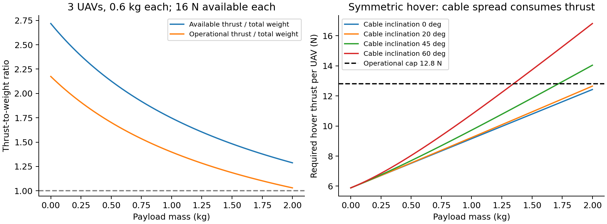
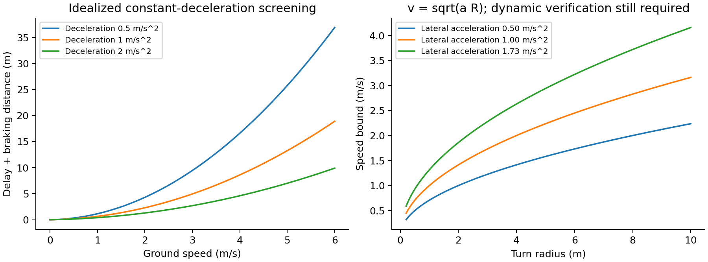
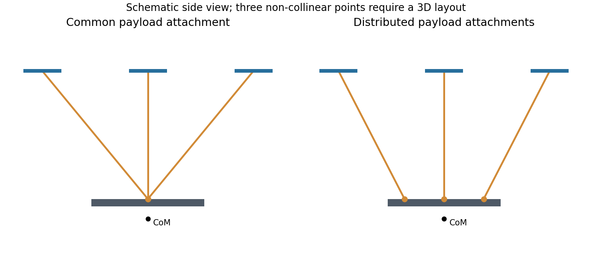

# 阅读结论与证据边界

**用于第一轮仿真，建议采用三架含电池质量各0.6 kg的多旋翼、0.6 kg刚性载荷、1 m绳长、20°初始绳角，先以1 m/s速度、0.5 m/s²加速度开展闭环验证。**这是一组经过静力一致性核查的研究初值，尚未经过完整动力学仿真或实飞验证，不构成实际安全飞行限值。机体质量与绳长参考已有联合吊运实验尺度，其余工程假设均在参数表中标明。

本报告最重要的判断是：**载重和推重比不能唯一决定安全飞行速度。**推重比主要决定推力与加速度裕度；速度限制必须同时给出风、载荷阻力、路径曲率、制动空间、绳索状态、控制器与测量时延。不能把市售机的最大速度直接作为多机吊运的安全速度，也不能简单相加各机标称载重。

研究范围为电动多旋翼通过柔性绳索搬运刚性载荷，重点考虑三机系统，补充两机与更多机情况。厂商单机产品用于证明工程质量尺度、载荷与性能关系；联合吊运可行性由原始论文的实体实验佐证。**没有把市售单机运输产品写成已经具备多机联合吊运功能的产品。**

本文采用四种标记：

| 标记 | 含义 | 可怎样使用 |
|---|---|---|
| E1 | 厂商原始规格或手册直接给出 | 使用时保留配置、版本和试验条件 |
| E2 | 原始论文直接给出；另标明实验或仿真 | 用于研究对照；不能自动外推其他平台 |
| C | 依据明示模型计算或本文推导 | 可用附带脚本复算；适用边界见公式说明 |
| A | 本报告建议的研究假设 | 需要辨识、敏感性分析和闭环验证 |

检索与核验日期为2026年10月31日。这是围绕研究问题的定向调查，不宣称穷尽全部文献。优先采用厂商官网、官方手册、会议原始论文、期刊作者稿和作者代码。搜索摘要只用来定位资料；未读到全文的材料不用于支撑详细的定量结论。

# 第一部分：主要任务

## 1. 质量和推重比的统一口径

“机体重量”在不同资料中可能是不含电池空机，也可能是含电池的可飞行平台。仿真必须用质量kg，受力计算用N；1 kg质量的重力在本文为9.81 N，1 kgf为9.80665 N。

定义：

| 符号 | 定义 |
|---|---|
| $m_i$ | 第$i$架无人机实际飞行配置质量，含电池、机载计算、定位设备和机上连接件 |
| $m_L$ | 被吊物、吊具和归入载荷侧连接件的总质量 |
| $m_c$ | 未并入上述质量的绳索质量；简化模型可置零，后续单独加回 |
| $M$ | 系统总质量，$M=\sum_i m_i+m_L+m_c$ |
| $f_i$ | 第$i$架无人机各旋翼合成推力的大小，单位N |
| $t_i$ | 第$i$根绳索的张力大小，单位N；绳索只能拉，不能推 |
| $f_{i,\mathrm{ref}}$ | 明确试验条件下的参考推力或控制上限，须注明是持续值还是峰值 |
| $f_{i,\mathrm{av}}$ | 当前电压、温度、空气密度和持续时间下可用的推力上限 |
| $f_{i,\mathrm{op}}$ | 规划器采用的工作上限，$f_{i,\mathrm{op}}=\eta_i f_{i,\mathrm{av}}$，$0<\eta_i<1$ |

本文明确区分以下推重比：

$$\lambda_{i,0}=\frac{f_{i,\mathrm{av}}}{m_i g},\qquad
\lambda_{\mathrm{sys}}=\frac{\sum_i f_{i,\mathrm{av}}}{Mg},\qquad
\lambda_{\mathrm{op}}=\frac{\sum_i f_{i,\mathrm{op}}}{Mg}. \tag{1}$$

其中$\lambda_{i,0}$是单机不带外载时的比值，分母仍包含电池；$\lambda_{\mathrm{sys}}$是总量筛查指标。**由于绳索内力、各机倾斜方向不同，系统推力标量之和并不等于可随意分配的载荷合力；总量合格不能代替逐机检查。**

若以静态垂直分担比例$\alpha_i$定义等效带载质量，则

$$\lambda_{i,L}=\frac{f_{i,\mathrm{av}}}{g(m_i+\alpha_i m_L)},\qquad \sum_i\alpha_i=1.\tag{2}$$

它便于比较，但非对称吊点、偏心载荷和机动时$\alpha_i$不是固定的$1/n$。更实用的逐机指标是$h_i=f_{i,\mathrm{av}}-\|\boldsymbol f_{i,\mathrm{req}}\|$，同时检查推力变化率和姿态力矩裕度。

## 2. 市售实物的原始证据

### 2.1 厂商数据对照

下表内速度是厂商在相应条件下公布的产品性能或配置值，**不是本文认定的多机吊运安全速度**。

| 平台及来源 | 质量和载荷 | 推力/推重比证据 | 速度及使用限制 |
|---|---|---|---|
| DJI FlyCart 30，E1，[R1–R3] | 不含电池42.5 kg；双电池65 kg；最大起飞质量95 kg；双电池载荷30 kg | 所读官方资料没有给出可用于复现的最大持续总推力，不据此反推确定推重比 | 20 m/s，注明海平面、无风、30 kg载荷；手册说明S模式可调至20 m/s，F模式为微调用途而限速 |
| Freefly ALTA X Gen1，E1，[R4–R6] | 技术页：空重10.4 kg，最大载荷15.9 kg，最大起飞质量34.9 kg；性能表的含电池基准配置约19.63 kg | 官方性能表有载荷—推重比数据，见下节；这是本次最直接的市售证据 | 位置模式默认最大速度20 m/s；宣传页另列超过95 km/h，条件不完整，不作为带载速度依据 |
| Bitcraze Crazyflie 2.1 Brushless，E1，[R7] | 带支腿起飞质量34 g；带桨保护37 g；推荐最大原厂载荷40 g | 每电机最高30 gf，四电机合计约1.177 N；这个数未明确为全飞行周期可持续保证值 | 所读产品页未给出带载速度包线；不能自行填入一个“官方最大安全速度” |
| DJI FlyCart 100，E1，[R8] | 带起吊系统55.2 kg、带旗舰空吊系统60.2 kg，均明确排除电池、双电池仓及附件、绳索和吊钩；性能最大起飞质量170 kg，部分区域149.9 kg | 未获得可复现的最大持续总推力 | 双电池、海平面、25°C无风条件列20 m/s；这不能与不含电池质量直接组合计算带载推重比 |

直接来源：[FlyCart 30规格](https://www.dji.com/flycart-30/specs)、[FlyCart 30手册v1.1](https://dl.djicdn.com/downloads/DJI_FlyCart_30/20250709/DJI_FlyCart_30_User_Manual_v1.1_0709.pdf)、[ALTA X技术规格](https://docs.freeflysystems.com/products/products/alta-x/untitled-3/technical-specs)、[ALTA X性能规格](https://docs.freeflysystems.com/products/products/alta-x/untitled-3/performance-specs)、[Crazyflie产品页](https://www.bitcraze.io/products/crazyflie-2-1-brushless/)、[FlyCart 100规格](https://www.dji.com/flycart-100/specs)。

上述产品跨越克级实验平台与百千克级运输平台，但不能按质量直接缩放控制参数。桨盘面积、翼载、转动惯量、驱动带宽、绳索空气阻力和测量相对误差均随尺度改变。

### 2.2 ALTA X：载荷增加如何压缩推重比

官网性能表的部分原始数据如下。总质量由表内磅值乘0.45359237换算，显示为两位小数；载荷也按原始磅值换算。[R5，E1；换算为C]

| 原始载荷lb | 换算载荷kg | 原始总质量lb | 换算总质量kg | 官网推重比 |
|---:|---:|---:|---:|---:|
| 0 | 0.00 | 43.28 | 19.63 | 3.5 |
| 10 | 4.54 | 53.28 | 24.17 | 2.8 |
| 20 | 9.07 | 63.28 | 28.70 | 2.4 |
| 30 | 13.61 | 73.28 | 33.24 | 2.0 |
| 35 | 15.88 | 78.28 | 35.51 | 1.9，**存在资料冲突** |

这组数据直接展示了同平台增加载荷后推重比下降的趋势。总质量乘推重比在约67–69 kg等效质量范围，基本符合固定可用推力量级、比值经取整的规律，但**不能据此认定获得了电机连续推力曲线**。

发现的冲突是：最后一行35.51 kg超过技术页34.9 kg最大起飞质量；宣传页又称35 lb载荷下维持2:1。资料未充分说明是否来自不同电池配置或版本。[R4–R6] 本报告不替厂商推断原因，不用最后一行作为合规起飞配置；正式选型应取具体序列号、动力版本与电池的受控手册，并遵守较严格质量上限。**本报告的仿真初值不依赖这行冲突数据。**

### 2.3 两个可复算的质量口径案例

**FlyCart 30：**双电池配置$65+30=95$ kg，载荷/含电池机体质量为$30/65=0.462$，载荷占总质量31.6%。若误用42.5 kg作为飞行配置质量，分母会小22.5 kg。[R1，E1；比例为C] 手册另外说明单电池模式只在特殊情况下使用；不能仅因其可增加载重就认为总体性能更好。[R2，printed p.71]

**Crazyflie Brushless：**按带支腿34 g及40 g载荷，静态垂直等效推重比为$120/(34+40)=1.62$；按带保护37 g则为1.56。这里的120是gf等效质量，比例中单位约去；换成N计算结论相同。[R7，E1、C] 这两个值均以最高标称推力为分子，不是低电量持续能力。定位板、绳端连接件等还会增加质量。

### 2.4 速度证据怎样解释

FlyCart 30手册S模式部分要求在无风时至少留出50 m制动距离，并指出该模式障碍感知性能降低。[R2，printed p.61] 这直接说明“达到20 m/s”与“在狭小空间内安全停止”是不同的问题。其15 m/s航程测试也不等于最大续航时间、最大载荷和任意绳长能同时成立。[R1]

单机吊运产品提供了绳索摆动抑制等功能，但所读资料没有给出其内部控制律；不能称其已采用某一种几何控制或MPC算法。FlyCart 30绞车指南明确双电池5–30 kg、单电池最高40 kg的载荷范围，另有摆动控制设置。[R3] 这支持“实物系统需要专门处理吊载摆动”，不支持将其单机参数直接搬进多机联合系统。

## 3. 联合吊运原始论文中的实体证据

| 原始研究 | 可核实的系统参数与证据层级 | 对初值选择的用途 |
|---|---|---|
| Sreenath & Kumar，RSS 2013，[R9] | Table III：三机实验系统采用每机0.5 kg、载荷0.225 kg、绳长1 m；正文IV-B为Hummingbird实体实验，E2 | 可构建较轻载的论文复现组；原文对绳索非负张力及松紧切换建模 |
| Lee，CDC 2014，[R10] | Section V数值算例：每机0.755 kg，三机，载荷1.5 kg，绳长1 m，E2仿真 | 可用于几何控制公式核查；**该组参数不能写成实飞验证** |
| Sun等，Science Robotics 2025，[R11] | 三机每机0.6 kg，载荷1.4 kg，绳长1 m，分布式挂点；实体试验Fast参考为5 m/s、8 m/s²，E2 | 为更高载荷与机动的对照尺度；论文Fig.2的限推力试验涉及20 N参考上限，可借作建模参考而非持续推力认证 |

直接文献：[RSS 2013原文](https://roboticsproceedings.org/rss09/p11.pdf)、[Lee 2014作者稿](https://arxiv.org/abs/1403.3684)、[Sun等2025原文及补充材料](https://arxiv.org/html/2501.18802v2)。

这三项证据说明研究尺度有实物基础，但并不形成一条可跨论文拟合的“载荷—安全速度曲线”。各研究的吊点、惯量、参考轨迹、推力上限和状态估计不同，少量案例也不足以建立统计安全上限。

## 4. 受力模型：载重和推重比怎样连接

### 4.1 统一坐标和绳索约束

以下为本文采用的Newton–Euler形式，与原始联合吊运建模框架一致。[R9–R11] 世界坐标$z$向上，$\boldsymbol e_3=[0,0,1]^T$。定义$\boldsymbol u_i$为**从载荷挂点指向无人机挂点**的单位向量；$\boldsymbol d$为气动力等外力，可含风扰。

$$m_i\ddot{\boldsymbol x}_i
=\boldsymbol f_i-m_i g\boldsymbol e_3-t_i\boldsymbol u_i+\boldsymbol d_i,\tag{3}$$

$$m_L\ddot{\boldsymbol x}_L
=\sum_i t_i\boldsymbol u_i-m_Lg\boldsymbol e_3+\boldsymbol d_L,\tag{4}$$

$$J_L\dot{\boldsymbol\omega}_L+\boldsymbol\omega_L\times J_L\boldsymbol\omega_L
=\sum_i\boldsymbol r_i\times(R_L^T t_i\boldsymbol u_i)+\boldsymbol\tau_{d,L}.\tag{5}$$

其中$\boldsymbol r_i$在载荷体坐标中表示，$R_L$将其转到世界坐标；式(5)全部力矩在载荷体坐标表达。无人机挂点若偏离其质心，还必须给机体姿态方程加入绳张力产生的力矩。

设两端挂点距离为$d_i$、不可伸长绳长为$l_i$，绳的单边约束为

$$l_i-d_i\geq0,\quad t_i\geq0,\quad t_i(l_i-d_i)=0.\tag{6}$$

绷紧时$d_i=l_i$；松绳时$t_i=0$。速度约束和重新拉紧时的冲击还需由完整求解器处理。把$l_i$始终作为固定杆长而允许负张力，会让仿真凭空出现“绳索推力”，虚增机动能力。

式(3)给出最直接的逐机推力需求：

$$\boldsymbol f_{i,\mathrm{req}}
=m_i(\ddot{\boldsymbol x}_i+g\boldsymbol e_3)+t_i\boldsymbol u_i-\boldsymbol d_i.\tag{7}$$

必须同时满足$\|\boldsymbol f_{i,\mathrm{req}}\|\leq f_{i,\mathrm{op}}$、允许倾角、旋翼分配后的单电机限制及姿态力矩限制。只检查合成推力而不检查控制分配，可能漏掉某个电机先饱和的情况。

### 4.2 对称悬停时的绳角代价

假设同型$n$机、无风、静止、等分垂直载荷，绳索与竖直夹角为$\theta$，水平分量对称抵消。载荷挂点布置也应使合力矩为零。则

$$t=\frac{m_Lg}{n\cos\theta},\tag{8}$$

$$f_{\mathrm{hover}}=
g\sqrt{\left(m_i+\frac{m_L}{n}\right)^2+
\left(\frac{m_L}{n}\tan\theta\right)^2},\tag{9}$$

$$\tan\phi_i=\frac{(m_L/n)\tan\theta}{m_i+m_L/n},\tag{10}$$

其中$\phi_i$是无人机推力轴相对竖直的倾角。**绳角$\theta$与机体倾角$\phi_i$不是同一个量。**绳索张力需要除以$\cos\theta$，但不能把无人机全部重量也一律除以$\cos\theta$，除非作了额外姿态假设。

绳角从20°增加到45°、60°时，张力相对垂直吊绳分别变为1.064、1.414、2倍。增大机间距有助于避碰，却会增加张力和悬停推力；这构成几何设计与动力裕度的直接权衡。

### 4.3 载荷能力的初筛

忽略绳角、阻力和各机差异时，若希望工作推重比至少为$\lambda_*$，有

$$m_L\leq\frac{\sum_i f_{i,\mathrm{op}}}{\lambda_*g}-\sum_i m_i-m_c.\tag{11}$$

这是理想化总量筛查，不是联合吊运额定载荷公式。随后要用式(7)–(10)、载荷姿态力矩、吊点可行性和分配优化逐机核验。不存在对所有机型、气候和算法都成立的“推重比必须2”定律；2左右可以是便于研究的起点，必须写明其分子与分母。

理想无阻力单合力模型下，平飞加速度$a_h$需要

$$f_{\mathrm{tot}}=M\sqrt{g^2+a_h^2},\qquad
a_h\leq g\sqrt{\lambda_{\mathrm{op}}^2-1}.\tag{12}$$

式(12)忽略绳内力，且假设可把总推力作为一个任意方向合力，是**乐观上界**。例如$\lambda_{\mathrm{op}}=1.5$时得到10.97 m/s²，不应据此宣称联合吊运可以持续如此加速；倾角、绳摆及内外环带宽往往先成为限制。

### 4.4 环境与电池如何改变结论

同一桨在相同转速和相近工作状态下可用$T\propto\rho\omega^2$理解密度和转速影响；固定可用功率、理想动量理论悬停近似下则有$T\propto\rho^{1/3}$。两者条件不同，不能混用为精确高原降额公式。前飞来流、共轴干扰和电压变化也不能仅用一个密度比例完全描述。[旋翼建模参考R22；此处尺度分析为C]

仿真可先令$f_{\mathrm{av}}=\kappa f_{\mathrm{ref}}$，但$\kappa$必须标记为辨识结果或假设。本文取0.8只做敏感性设计；并不声称任何平台降额必然为20%。随后再乘$\eta=0.8$保留规划裕度，得到0.64倍参考上限。**物理降额与规划留量含义不同，应避免重复或不明原因地多次折减。**

### 4.5 为什么还必须检查功率和续航

推重比只说明力的能力，不说明能够持续多久。理想孤立桨盘悬停诱导功率满足$P_{\mathrm{ind}}=T^{3/2}/\sqrt{2\rho A}$；真实电功率还包含桨型阻力、传动/电机损耗与机载设备功耗。该关系也给出上一节固定理想诱导功率时的密度尺度。[R22所用动量理论；此处关系与推论为C]

同一桨盘、其他条件相同时，若悬停推力增加20%，诱导功率约增加$1.2^{3/2}-1=31.5\%$。因此增加载荷可能比直觉更快地消耗电池，并导致更早进入低电压降额。多机中的附加横向内力同样需要推力和功率，不能因其对载荷合力相互抵消就忽略。

在理想均匀分担条件下，增加一架同型机带来的载荷增量上界约为$f_{\mathrm{op}}/(\lambda_*g)-m_i$，还需扣新增绳索和吊具；并不是增加一架就免费增加其全部最大推力对应的载荷。更多飞机虽可能增加总桨盘面积，也会增加机体、电池及协调成本。

前飞时诱导功率和寄生阻力的变化方向不同，不能笼统认为“速度越慢，航程或续航一定越好”。任务还要约束返航剩余能量和降落余量，不能采用厂商放电到0%的极限续航作为可用任务时间。[工程分析；具体功率模型需辨识]

## 5. 安全飞行速度：必须同时检查的约束

### 5.1 空速、地速和阻力

路径与制动使用地速$\boldsymbol v_g$；气动使用相对空气速度$\boldsymbol v_a=\boldsymbol v_g-\boldsymbol w$。在简化二次阻力模型中

$$\boldsymbol d=-\tfrac12\rho C_DA\|\boldsymbol v_a\|\boldsymbol v_a.\tag{13}$$

载荷需按方向、姿态和形状设置$C_DA$；绳索也可单独计算。把不规则载荷一律视为无阻力点质量，会高估速度能力。二次阻力是研究简化，不能完全描述旋翼来流耦合。[R12；模型取舍为A]

若用单合力筛查模型，零竖直加速度时的水平力上界为

$$F_{h,\mathrm{screen}}=
\min\left\{\sqrt{\left(\sum_i f_{i,\mathrm{op}}\right)^2-(Mg)^2},
Mg\tan\phi_{\max}\right\}.\tag{14}$$

稳态直线无风、无机动时，相应阻力速度上界为

$$v_{a,\mathrm{drag}}\leq\sqrt{\frac{2F_{h,\mathrm{screen}}}{\rho(C_DA)_{\mathrm{eff}}}}.\tag{15}$$

这同样只是初筛。它没有扣除逐机的绳索水平内力，也没有分配姿态控制力矩。逆风不能简单只减一个“速度裕度”，应对每个机体、载荷和绳段重新计算相对来流与受力。

### 5.2 加速度、急动度与摆动

固定支点、单根无质量绳、小角度摆的参考关系为

$$\omega_p\simeq\sqrt{g/l},\qquad T_p\simeq2\pi\sqrt{l/g},\qquad
\tan\psi_{\mathrm{eq}}=a_h/g.\tag{16}$$

1 m绳对应参考周期约2.01 s，5 m约4.49 s，20 m约8.97 s。真实多机系统支点会运动且存在多个耦合模态；这些周期只用于理解量级，**不是其完整特征值**。可动单支点的简化系统自身也会有质量比修正。

若暂以10°等效摆角作为筛查阈值，则$a_h\approx g\tan10°=1.73$ m/s²。但突变加速度会产生超调，有限急动度也不能单凭一个上限保证无摆。本文初值采用0.5 m/s²、1 m/s³，并要求后续检查完整绳角偏差和载荷姿态。这里10°是相对任务参考的动态偏差指标，**不是要求所有几何绳角小于10°**；基准绳角本身为20°。

### 5.3 转弯半径

匀速转弯的必要关系为

$$a_c=v_g^2/R,\qquad v_g\leq\sqrt{a_{h,\mathrm{allow}}R}.\tag{17}$$

采用上面的1.73 m/s²筛查值时，2 m转弯半径对应1.86 m/s，10 m半径对应4.16 m/s。相同速度下半径更小，所需侧向加速度更大；这也是只报“最高速度”而不报曲率没有工程意义的原因。

### 5.4 制动空间与时延

延迟$\tau$后使用恒定减速度$a_b>0$的理想制动距离为

$$d_{\mathrm{stop}}\geq v_g\tau+\frac{v_g^2}{2a_b},\qquad
v_g\leq-a_b\tau+\sqrt{(a_b\tau)^2+2a_b d_{\mathrm{free}}}.\tag{18}$$

实际还应扣除载荷、绳索、机体扫掠包络和定位误差后的可用净空间；加入急动度限制、制动反向摆动和风扰后距离通常更大。$d_{\mathrm{free}}=3$ m、$a_b=0.5$ m/s²、$\tau=0.15$ s时，上式为1.66 m/s；1 m/s理想制动距离为1.15 m。[C] 不能把1.66 m/s当成已验证安全上限。

### 5.5 总体速度应怎样报告

建议把速度报告写成以下形式：

> 在给定载荷、绳长/挂点、风场、路径、感知与控制条件下，某速度—加速度—急动度组合通过指定工况集；最小张力、最大逐机推力、载荷姿态偏差、最小间距和制动空间均满足给定阈值。

初筛可取阻力、转弯、制动、厂商限制等所得上界的最小值；**取最小值仍不能证明完整非线性系统安全**。最终应以式(3)–(7)及执行器、碰撞约束进行时间域验证或带可验证假设的可达性/鲁棒控制分析。

以B0、有效水平$C_DA=0.15$ m²、25°倾角作整体筛查，式(14)–(15)得到无风匀速阻力上界约10.93 m/s；然而上面2 m半径的摆动筛查为1.86 m/s，3 m制动空间筛查为1.66 m/s。它们相差很大，说明仅由动力和阻力算出的高速值不适合作为初始指令。[A、C] 选择1 m/s只是给这些简化约束留出研究余量，还需闭环核验。

同一假设下，地速1 m/s遭遇3 m/s正逆风时，相对空速4 m/s，整体阻力约1.47 N，对2.4 kg系统相当于0.61 m/s²的力需求；若还加速0.5 m/s²，则对应水平需求约1.11 m/s²。逆风升到5 m/s时，这一需求约1.88 m/s²，已超过10°等效摆动筛查的1.73 m/s²。[C] 该算例只说明风裕度的重要性；各机真实负载、载荷摆动和旋翼气动仍需分别计算。

## 6. 可直接录入仿真的初始参数

### 6.1 基准B0：先建立能够解释的轻载闭环

以下配置设计为对称三角布置。机体质量及绳长采用已验证实验的量级；本配置**不是对某篇论文的整机精确复刻**。

| 参数 | B0建议值 | 性质和依据 |
|---|---|---|
| 无人机数量$n$ | 3 | A；便于研究非共线挂点和载荷姿态 |
| 每机实际飞行质量$m_i$ | 0.600 kg | E2尺度参考R11；移用到本配置为A |
| 刚性载荷总质量$m_L$ | 0.600 kg，含载荷侧吊具 | A；降低初期调试负担 |
| 绳长$l_i$ | 1.000 m，三根相同 | E2参考R9、R11；本配置采用 |
| 参考合成推力$f_{i,\mathrm{ref}}$ | 20 N/机 | R11限推力试验参考量级；本配置采用为A，不称其持续额定值 |
| 物理可用推力$f_{i,\mathrm{av}}$ | 16 N/机 | A：$\kappa=0.8$ |
| 规划工作上限$f_{i,\mathrm{op}}$ | 12.8 N/机 | A：$\eta=0.8$ |
| 载荷尺寸 | 0.30×0.30×0.10 m均匀实心长方体 | A；用于明确定义惯量，不对应原论文载荷 |
| 载荷惯量$J_L$ | diag(0.005, 0.005, 0.009) kg·m² | C：按均匀长方体计算 |
| 单机惯量$J_i$ | diag(0.003, 0.003, 0.005) kg·m² | A；必须用目标机CAD或摆锤辨识替换 |
| 载荷挂点$\boldsymbol r_i$ | (0.150,0,0.050)、(-0.075,0.129904,0.050)、(-0.075,-0.129904,0.050) m | A；体坐标，挂点位于顶面 |
| 无人机挂点 | 机体质心处 | A；便于首轮模型核查；后续改为实际偏置 |
| 初始绳索对竖直夹角 | 20°，按0°/120°/240°方位外张 | A；不等同于摆角误差 |
| 单根绳索结构张力限值 | 10 N | A，仅仿真占位；不是绳材认证强度 |
| 规划最小张力 | 0.3 N | A；基准静张力约2.09 N；松绳模型中允许真实张力降至0 |
| 机体最大倾角 | 25° | A；还需逐机计算可用机动倾角 |
| 起始速度、加速度、急动度上限 | 1 m/s、0.5 m/s²、1 m/s³ | A；先从0.5 m/s执行平滑轨迹，再升至1 m/s |
| 等效动态摆动预警 | 相对参考10° | A；分布式系统需用各绳方向偏差和载荷姿态分别统计 |
| 风场 | 基准无风；敏感性1/3/5 m/s | A；包括侧风与逆风，不把5 m/s声明为已安全 |
| 空气密度 | 1.225 kg/m³ | A；海平面标准量级；按实际温压替换 |
| 每机$(C_DA)_{xyz}$ | (0.02,0.02,0.01) m² | A；固定姿态简化，不含旋翼来流模型 |
| 载荷$(C_DA)_{xyz}$ | (0.09,0.09,0.09) m² | A；便于首轮敏感性，不是实测阻力 |
| 电机一阶响应时间常数 | 0.04 s | A；敏感性0.02–0.10 s；不能代替转速—推力辨识 |
| 仿真积分步长 | 0.001 s | A；须进行步长减半与约束残差检查 |
| 姿态/几何外环更新率 | 500/100 Hz | A；取决于实现，需满足算力时限 |
| NMPC初始更新率 | 20 Hz，内环独立运行 | A；20 Hz意味着每次求解及通信总预算小于50 ms |
| 名义端到端时延 | 20 ms | A；另测0/20/50/100 ms及随机抖动；式(18)算例另取150 ms |
| 电池、热和密度变化 | 用$\kappa$做0.6/0.8/1.0敏感性 | A；在得到曲线后替换为状态相关模型 |

质量分配规则：无人机上的连接件归$m_i$，载荷上的连接件归$m_L$，有限质量绳索单列，避免重复计数。无质量绳是基础模型的假设，不代表真实绳索没有质量。

初始化不能只输入位置而把所有机体都设为水平。以载荷质心$(0,0,1)$ m、载荷水平、无人机挂点位于自身质心时：

$$\boldsymbol u_i=[\sin20°\cos\gamma_i,\ \sin20°\sin\gamma_i,\ \cos20°]^T,
\quad\gamma_i\in\{0°,120°,240°\},$$

$$\boldsymbol x_i=\boldsymbol x_L+\boldsymbol r_i+l_i\boldsymbol u_i.\tag{19}$$

得到以下无人机质心位置，单位m：[C]

| 无人机 | $x$ | $y$ | $z$ |
|---|---:|---:|---:|
| 1 | 0.492020 | 0 | 1.989693 |
| 2 | -0.246010 | 0.426102 | 1.989693 |
| 3 | -0.246010 | -0.426102 | 1.989693 |

初始速度和角速度为零；按式(7)设置推力轴，每机外倾约5.20°，不是20°；初始yaw可取0，并构造与推力轴一致的旋转矩阵/四元数。[C] JSON给出了推力轴，使用NED飞控时需转换坐标和推力符号。

若改用机体下方0.03 m挂点等实际设置，式(19)要减去$R_i\boldsymbol b_i$，并重新平衡机体力矩；不能只平移位置而保留原姿态与电机输出。

### 6.2 静力计算与质量扫描

对B0，系统$M=2.4$ kg，$\lambda_{\mathrm{sys}}=2.039$，$\lambda_{\mathrm{op}}=1.631$。20°绳角下，单绳张力2.088 N，每机悬停推力7.880 N，占物理可用16 N的49.3%，占规划12.8 N的61.6%。这些百分比是**推力占比，不能当作PWM油门百分比**。[C]

| 总载荷kg | 系统可用推重比 | 规划推重比 | 每机悬停推力N | 每绳张力N | 悬停/规划上限 |
|---:|---:|---:|---:|---:|---:|
| 0.30 | 2.330 | 1.864 | 6.876 | 1.044 | 53.7% |
| 0.60 | 2.039 | 1.631 | 7.880 | 2.088 | 61.6% |
| 1.00 | 1.747 | 1.398 | 9.233 | 3.480 | 72.1% |
| 1.40 | 1.529 | 1.223 | 10.596 | 4.872 | 82.8% |
| 1.80 | 1.359 | 1.087 | 11.965 | 6.264 | 93.5% |

同样的平台在1.8 kg载荷下仍可能满足静态悬停，但剩余规划推力很少，不适合作为首次机动验证。**能悬停与具备足够抗扰/机动裕度是两个条件。**本文不把这些静态合格点标记为“安全可飞”。

三机中心间距约0.852 m。若暂用每机0.15 m包络半径和额外0.15 m净间隔，则要求中心距至少0.45 m，初始几何满足。[A、C] 真机需用桨尖半径、误差、倾斜扫掠、尾流及绳索位置替换该占位判据。

### 6.3 建议的对照组

| 组别 | 用途 | 设置与限制 |
|---|---|---|
| B0 | 首个闭环基准 | 上述0.6 kg载荷；先静止，再0.5–1 m/s平滑平移 |
| B1 | 载荷敏感性 | 逐步加至1.0、1.4 kg，保留B0几何；各自重新初始化、计算惯量与张力，不声称复现R11 |
| P2013 | 原论文参数复现 | 按R9 Table III完整导入质量、惯量、挂点和绳长；原文NED/符号转换后再实现 |
| L2014 | 几何控制公式复现 | 按R10的数值例完整导入；与其原始模型假设一致时比较，不作为实飞指标 |
| S2025 | 高机动挑战 | R11实物尺度为参考；完整补齐其挂点、惯量、推力与控制结构后才可称复现；5 m/s、8 m/s²仅作后期目标 |

更改均匀箱体载荷质量时，惯量按质量同比缩放；若模拟真实“加装一个重物”，则要重新计算质心和惯量，不能只改$m_L$。

## 7. 推荐验证顺序与验收记录

1. **静力与约束核查。**在所有初始状态检查力/力矩平衡、绳长与速度约束、正张力、机体姿态和单电机分配。B0解析脚本已核查载荷合力、合力矩和绳长；没有核查真实电机分配矩阵，因为未提供目标硬件。
2. **低速闭环。**先悬停60 s，再执行静止起止的五次多项式或S曲线平移；记录全过程峰值，不能只看到达终点。对步长减半和控制更新率变化做一致性检查。
3. **分离参数影响。**单独扫描载荷、绳角、绳长、阻力、推力降额、惯量、质量误差和时延；再组合最不利因素。不要一开始同时改变所有参数后无法解释失稳原因。
4. **逐步增加机动。**速度0.5/1/2/3/5 m/s按序进行，每级同时规定加速度、急动度、转弯半径和停止距离；若不可行，应降低参考，而不是继续升速。
5. **松绳、冲击与故障。**加入起吊/放下载荷、绳索重新绷紧、短时通信中断和单机推力能力下降。故障工况的目标应定义为受控降落或中止；不能默认少一架仍可保持全姿态运输。

建议首轮研究判据如下，全部为A，不是行业标准：无碰撞、没有非物理负张力、名义全绷紧任务$t_i\geq0.3$ N、推力不超过12.8 N、无单电机饱和、机体倾角不超过25°、载荷位置RMSE不超过0.10 m且峰值不超过0.25 m；若任务要求水平载荷，姿态偏差峰值先取10°。跟踪失败、松绳、求解超时和约束违反分别计数，不能用平均RMSE掩盖。

为了定义“通过速度”，每组固定任务至少报告：实际速度/加速度峰值、各机推力峰值与最小裕度、张力上下界、绳方向误差、载荷姿态误差、最小机间距、绳段最小间距、与障碍最小距离、制动所需空间、求解时延分布及超时次数。对随机风和噪声固定随机种子，至少20个种子作为第一轮统计；样本数20仍不能证明低概率事故率。

若需要从仿真进入实机，最先补充的辨识是：低电压持续推力与力矩曲线、质量/惯量/挂点坐标、载荷阻力、绳索刚度阻尼、推力执行器动态，以及端到端时间戳误差。它们对可信速度包线的影响通常大于在未辨识模型上继续调小跟踪误差。

## 8. 主要任务自我审查与修订结果

| 审查问题 | 结果与处理 |
|---|---|
| 是否把空机质量直接用于飞行推重比？ | 已分开；B0按含电池配置定义，厂商数据保留原始口径 |
| 是否混淆最大载荷、MTOW和最高速度？ | 已分开，未假设各极限同时成立 |
| 是否把单机产品当成联合吊运实物？ | 已排除；联合系统由R9、R11实验支撑 |
| 是否把论文数值算例写成实体实验？ | 已排除；R10明确标为仿真 |
| 是否按厂商最大载荷反推最大推力？ | 未反推DJI推力；Bitcraze注明峰值条件不全；ALTA X只引用官方比值 |
| 原始资料存在冲突时是否隐藏？ | 明示ALTA X表末行超过其技术页MTOW，未作为推荐输入 |
| 是否错误地把总质量全部除以绳角余弦？ | 已用逐机受力推导式(9)，区分绳角和机体倾角 |
| 是否把总推力足够当成逐机均可承受？ | 明确需要逐机张力、推力、姿态和电机分配验证 |
| 推荐速度是否被写成验证过的安全值？ | 未作此声明；1 m/s为待闭环验证研究初值 |
| 参数能否复算？ | 提供脚本、JSON、CSV、图；静力残差在浮点误差范围 |
| 是否已经获得完整速度包线？ | 尚未：当前交付为证据调查与解析初值；完整闭环包线需要目标硬件与动力学实现 |

**主要任务阶段结论：**现有证据足以支持质量口径、推重比趋势、初始模型和分级仿真方案；不足以支持某个任意多机系统的实飞安全速度承诺。主要任务的引用、计算和边界经过上述复核后，进入以下进阶分析。

# 第二部分：进阶任务

## 9. PID之外的控制方法及适用性

### 9.1 先按控制层级定位算法

多机吊运至少有四个需要协调的层级：载荷轨迹/姿态规划、绳索张力与方向分配、各机平移轨迹跟踪、各机姿态与电机分配。状态估计贯穿其中。论文提出“NMPC控制”时，底层仍可能保留已有姿态控制器；“几何控制”也经常与优化分配器组合。因此不能仅按算法名称断言某个系统已经在所有飞控层级替换了PID。

以下优缺点是在各类算法结构与所列原始研究基础上的工程分析，不是跨论文统一硬件条件下的定量排名。

| 方法 | 原始应用证据 | 优点及对吊运的价值 | 主要代价和边界 | 建议定位 |
|---|---|---|---|---|
| 几何控制：$SO(3)$、$SE(3)$、$S^2$ | R10给出完整非线性建模和数值例；R13给出几何控制加优化分配的实体系统 | 直接处理姿态和绳方向，避免欧拉角奇异；模型、误差和稳定性分析较清晰，计算量较小 | 不自动包含推力饱和、张力不等式和碰撞；稳定性证明依赖模型及增益/初始条件；级联带宽不足会限制机动 | 第一条实现路线，必须补约束分配与轨迹限幅 |
| NMPC/MPC | Li & Loianno，IROS 2023，仿真及实体联合吊运，[R14] | 可把动态、推力、张力、机间距和障碍约束放进同一预测问题；能主动减速和改变构型 | 模型、状态估计、初始化和求解时限敏感；非凸问题有局部解/无解；名义约束不等于真实受扰约束 | 第二条核心路线；优先完整耦合模型或说明降阶误差 |
| 在线全系统轨迹优化+INDI跟踪 | R11为联合吊运实体应用；INDI原理见R15 | 规划动态可行参考，机载快速补偿绳索力；有利于提高机动时的模型误差容忍度 | 需要高质量IMU、时间同步、执行器有效性和状态估计；不等于无需模型或无需定位；高层失效需有降级策略 | 有机载算力与传感条件后的高机动方向 |
| 自适应/模型参考自适应 | Villa等，IEEE Access 2021，两机实验，[R17]；自适应RISE两机实验，[R18] | 对质量或动力参数变化可在线补偿，适合装卸和载荷不确定性 | 参数收敛需可辨识性/激励；噪声导致漂移，应有投影、限幅等；快速故障或松绳不能视作缓慢参数变化 | 作为几何控制或低层补偿增强 |
| 滑模、高阶滑模、RISE类鲁棒跟踪 | 四旋翼反步/滑模原始应用R16；联合吊运RISE见R18 | 对满足设计条件的有界不确定扰动可较强；滑模形式便于理论分析，部分实现计算量较低 | 经典滑模易抖振，激发绳索和执行器；边界层/高阶形式有滤波、采样及残差权衡；对非匹配扰动不能笼统承诺完全抑制 | 可作抗扰对照；RISE与经典切换滑模应分开描述 |
| 反步控制 | Bouabdallah & Siegwart，ICRA 2005，四旋翼原始应用，[R16] | 适合严格反馈/级联结构，可系统构造Lyapunov函数并结合自适应 | 多级虚拟控制及其导数使实现复杂；微分噪声、模型误差和输入饱和影响大 | 对理论推导有价值；先确认吊运模型符合设计结构 |
| 鲁棒$H_\infty$与不确定性优化设计 | Sanalitro等，RA-L 2020，Fly-Crane实体系统，[R19] | 把参数不确定性和扰动到误差的增益纳入设计，适合精密搬运的鲁棒性分析 | 需要明确不确定集和性能权重，可能保守；原文多绳静态刚性结构不可直接外推到每机单绳结构 | 面向不确定性的对照方向 |
| 学习辅助MPC/自适应代价 | Auto-Multilift，arXiv v5，2024，[R20] | 学习MPC权重/参考参数，减少人工调参并处理构型变化；保留显式模型层 | 所读版本以仿真展示；训练分布外、误差传播和约束鲁棒性仍需验证；不能因为外面有MPC就默认安全 | 第三阶段扩展，先学权重或残差再考虑更直接控制 |
| 线性状态反馈/LQR或线性MPC | 本报告建议的局部基线，A；不将其写成所列论文已实飞结论 | 悬停附近便于纳入摆角、摆角速度，比仅位置PID更适合解释小扰动模态；可作公平对照 | 依赖线性化范围；大角度、松绳、构型变化需切换模型或重新设计 | 低速局部基准，用于判断高级方法增加的收益 |

直接文献入口：[几何控制与QP](https://arxiv.org/abs/2304.02359)、[协同NMPC](https://arxiv.org/abs/2303.06165)、[INDI期刊论文](https://doi.org/10.2514/1.G001490)、[自适应RISE](https://doi.org/10.1007/s10846-024-02174-4)、[鲁棒全姿态控制](https://iris.uniroma1.it/handle/11573/1688362)、[Auto-Multilift](https://arxiv.org/abs/2406.04858)。

### 9.2 几何控制为什么适合起步

其基本思路是由载荷位置、姿态误差生成所需六维合力与力矩，再分配到各根绳索，跟踪其方向和张力，最后转成每机推力与姿态。这与第4节的物理分层直接对应。姿态误差在旋转群上处理，绳方向在单位球面上处理，较容易区分载荷误差、绳方向误差和机体误差。[R10、R13]

但“几何”不是自动处理约束的同义词。直接用伪逆分配，可能使无人机互相接近、某机推力先饱和或绳索张力趋近零。Wahba与Hönig的工作用若干低维QP改进绳索力分配，并在最多三架小型多旋翼上进行机载微控制器实验。[R13] 这为第一条实现路线提供了可核查的落地依据。

### 9.3 NMPC的重点是模型和约束完整性

典型问题为在预测窗口内最小化载荷位置/姿态误差、控制变化与能耗代理量，并服从动力学、正张力、推力、倾角和碰撞约束。至少应区分两种模型：仅载荷状态的降阶NMPC，以及包含绳索/无人机动态或其可实现带宽的整体规划。前者计算较轻，但分配出的绳力不能瞬时实现；后者更能描述高机动，却需要更多算力与更完整辨识。[R14；比较分析为C/A]

实施时必须记录每步求解耗时、约束残差、可行解状态、热启动策略与参考更新机制。优化器超时后应执行已验证的上一段可行轨迹或预设降级策略，不能无限沿用一个旧控制量。

R11的高机动结果采用全系统轨迹规划与机载INDI组合。解读其性能时需保留两个条件：对照算法的高速失败结果来自该文仿真对比，不是所有几何控制/NMPC系统的普遍结论；没有载荷传感器，也不代表没有外部定位条件，其无人机定位使用了运动捕捉。[R11] 所以研究选择应比较完整架构，而不单比较标签。

### 9.4 抗扰与学习方法的合理位置

自适应、滑模和扰动观测器可改善模型误差或外力估计，却不能制造推力裕度。如果外力已经使式(7)不可行，提高增益只会加重饱和。把绳力全当作待消除扰动，也可能让各机局部位置控制相互“对抗”；需要区分载荷运动所需的协同张力与未建模扰动。[基于式(3)–(7)的分析]

R18中的两机棒状载荷实体研究给出了最高3.5 m/s²平移加速度工况，证明鲁棒自适应方法具有实物基础；它不证明两机可实现任意六维载荷姿态控制，也不等同于该加速度在所有姿态/风况下安全。Auto-Multilift所读版本明确以仿真为主要验证，应保持这一证据层级。[R18、R20]

优先推荐：几何控制+约束力分配作为可解释基准；NMPC作为约束与机动改进；再以INDI或鲁棒/自适应补偿降低模型误差影响。学习先用于调参、残差或参考调整，保留物理约束与超时处理。此顺序是本报告对研究成本和证据成熟度的判断，不是证明某种算法绝对最优。

### 9.5 近年进展与本轮核验范围

2026年的Bacheti等自适应滑模研究，原始摘要报告了最多五架飞行器的联合吊运实体试验，涉及外扰、载荷参数不确定性和编队重构。[R24] 这说明此方向的实验规模仍在推进。由于本轮未读取该文完整试验参数，不提取其载荷或速度作为仿真初值，也不将其摘要中的相对提升百分比用于跨算法排名。

## 10. 单挂点与分布式挂点：先定义拓扑

“单挂点”常同时指机体端或载荷端，容易导致误解。本文比较的是**载荷端**拓扑；除特别说明外，每架无人机通过一根绳连接载荷，各端为近似无摩擦万向连接，不传递扭矩。

| 形式 | 准确定义 | 建模影响 |
|---|---|---|
| 共点/V形 | 多根无人机绳直接连接载荷同一挂点 | 各绳对载荷的作用等效为同一点合力 |
| 汇合环/Y形 | 多根上段绳先到汇合环，再用下段绳连接载荷 | 增加汇合节点及下段摆动，不与V形共点模型等同 |
| 分布式 | 不同绳连接载荷不同的刚性挂点 | 可通过空间力臂形成载荷力矩；需要载荷惯量与姿态模型 |
| 多绳/机 | 一架无人机同时连接多根绳，如特定Fly-Crane结构 | 运动约束和力闭合性质改变，不能沿用“一机一绳”的可控性计数 |

Y形相比V形可增加欠驱动摆动自由度，已有专门建模研究。[R23] 因此研究代码、图示和参数文件都应写清绳段数量与连接图。

## 11. 可控性、张力分配与内力

### 11.1 共点：无法独立指定载荷全部姿态

若共同挂点就在载荷质心，全部绳索对质心的力矩为零。即使上方有很多架无人机，它们也不能通过这些理想绳索主动改变载荷姿态。若共同挂点偏离质心$\boldsymbol r$，则

$$\boldsymbol\tau_L=\boldsymbol r\times\boldsymbol F_L.\tag{20}$$

力矩随合力绑定，不能任意指定三轴力矩；绕质心—挂点连线的独立转矩缺失。重力可能形成部分被动姿态恢复，但不能据此宣称全姿态可控。各机改变自身yaw，若绳端不传扭矩，也不会直接改变载荷yaw。[力矩关系为C；模型与R9、R10一致]

因此共点更适合只需移动载荷质心、对姿态要求较低或另有被动稳定机构的任务。如果仿真要求“共点且保持任意三轴姿态”，应先检查是否偷偷加入了并不存在的执行力矩。

### 11.2 分布式：力矩能力来自挂点几何

令$\boldsymbol h_i=R_L^T(t_i\boldsymbol u_i)$，全部量在载荷体坐标下表达，则

$$\begin{bmatrix}\boldsymbol F_L^b\\\boldsymbol\tau_L^b\end{bmatrix}
=G\begin{bmatrix}\boldsymbol h_1\\\vdots\\\boldsymbol h_n\end{bmatrix},\qquad
G=\begin{bmatrix}I&I&\cdots&I\\{[\boldsymbol r_1]_\times}&[\boldsymbol r_2]_\times&\cdots&[\boldsymbol r_n]_\times\end{bmatrix}.\tag{21}$$

这是把每根绳的**三维期望力向量**当作分配变量的映射。其几何秩一般为：全部共点时3；两个不同挂点时5；至少三个非共线挂点时可以为6。[C；与R10、R13分配结构一致] 两点情况下，沿两点连线方向存在不能独立施加的力矩分量；对应姿态控制能力不足。

**一个关键限制：固定当前绳方向时，每根绳只有一个标量张力。**此时真正的瞬时映射为

$$A(\boldsymbol u)t=
\begin{bmatrix}
\boldsymbol u_1^b&\cdots&\boldsymbol u_n^b\\
\boldsymbol r_1\times\boldsymbol u_1^b&\cdots&\boldsymbol r_n\times\boldsymbol u_n^b
\end{bmatrix}t,\qquad t_i\geq0.\tag{22}$$

三根绳的$A$至多秩3。不能把式(21)的秩6解释为“当前三个固定方向的张力可立即产生任意六维力矩”。三机系统实现六维轨迹跟踪，需要借助无人机运动改变绳方向，并满足方向变化的动态限制、正张力和执行器限制。这正是多层控制和整体规划要处理的部分。

B0脚本算得$\operatorname{rank}(G)=6$、当前$\operatorname{rank}(A)=3$。这个对照帮助识别一个常见仿真错误：在分配器中把绳的方向当作瞬时可控变量，却没有让无人机实际移动到对应位置。

### 11.3 内力不搬运载荷，却占用动力

当式(21)存在冗余时，可形式化写为

$$h=G^\dagger w+(I-G^\dagger G)z.\tag{23}$$

第二项不改变载荷合力/合力矩，可用于调整编队、避免碰撞或平衡各机负担。但它仍可能增加各根绳索张力和无人机推力。这个零空间在三维期望力层面定义；固定绳方向时还要受式(22)和非负张力可行锥约束。

规划器不应只最小化载荷误差，还应惩罚无效内力、单机负载偏差和推力变化。遇到伪逆解不可行时，优先改变参考/构型或使用约束优化，不应把负张力直接截为零后仍声称维持原期望力矩。

## 12. 对机动、速度和算法的实际影响

| 比较维度 | 共点挂载 | 分布式挂载 | 对研究设计的含义 |
|---|---|---|---|
| 载荷姿态 | 姿态控制受根本几何限制，可能依赖被动恢复 | 适当挂点与动态构型可形成独立力矩 | 有明确姿态任务时优先非共线分布式 |
| 模型复杂度 | 可按点载荷研究平移；偏置挂点仍应保留姿态 | 必须包含刚体惯量、质心偏置及各挂点 | 点质量模型结果不能直接证明分布式刚体性能 |
| 摆动 | 共点不消除摆动；Y形还引入额外模态 | 平移、转动、绳方向耦合，可能主动抑摆 | 应分别记录载荷姿态与各绳偏差，不能仅一个摆角 |
| 编队与绳角 | 小载荷共点附近绳索集中，需避免机体聚拢 | 挂点本身提供部分间距，仍需约束 | 比较时固定机体真实包络和最小间距 |
| 快速旋转载荷 | 不能任意独立指定 | 远离质心的挂点增大力臂，也增加端点速度/加速度 | 姿态角速度不能脱离各机平移能力单独设置 |
| 狭窄空间 | 不能靠主动姿态任意调整载荷朝向；可调整上方编队 | 可利用载荷转姿和编队重构，但需完整扫掠空间 | 检查无人机、载荷及整段绳，而不是仅检查质心 |
| 同步误差 | 仍可能产生不均载和绳摆 | 不同挂点同步误差还容易产生载荷转矩 | 姿态任务对通信时延/坐标对齐可能更敏感 |
| 能耗和载重 | 受绳角和分担限制，无保证总更省电 | 主动姿态和内力调整可能消耗更多裕度 | 不存在不依赖任务的“哪种一定更快/更省电”结论 |
| 单机故障 | 剩余系统可能保留部分平移能力，需看动力与几何 | 三非共线点失去一路后常只剩两点结构，姿态能力下降 | 故障后重新分析秩、正张力与可用推力，目标改为安全降落 |

其中快速旋转载荷的代价可由挂点加速度直接看出：

$$\boldsymbol a_{\mathrm{attach},i}=\boldsymbol a_L+
\boldsymbol\alpha_L^w\times(R_L\boldsymbol r_i)+
\boldsymbol\omega_L^w\times\bigl(\boldsymbol\omega_L^w\times R_L\boldsymbol r_i\bigr).\tag{24}$$

无人机加速度还要加$l_i\ddot{\boldsymbol u}_i$，若机体挂点偏置还要包括机体转动项。故分布式挂点越外展，给定姿态角加速度下各机可能需要更高平移加速度；“更长力臂降低张力需求”与“端点运动更剧烈”需要共同权衡。[C]

### 12.1 建议的挂点对照试验

比较三种载荷端连接：质心共点、质心上方0.05 m共点、B0三点分布式。另将Y形作为单独扩展，明示汇合环质量和下段绳长。**采用两组公平比较**：一组固定绳长和绳角，观察系统占用空间变化；另一组固定初始机间距，允许按拓扑调整绳角，观察动力代价变化。否则无法区分拓扑本身与几何参数的影响。

平移任务使用同一载荷质心轨迹；姿态任务只在具备相应可控能力的拓扑上比较跟踪误差，对共点系统报告“任务不可实现”而不是把控制器调到极高增益。各组保持质量、推力和噪声设置一致，必要时加上结构本身新增质量。

建议挂点半径扫描0/0.05/0.15/0.25 m时同步调整载荷结构尺寸或把挂点解释为真实支架；不可把挂点放到所建刚体之外而不增加支架质量和惯量。每点扫描10°/20°/35°/45°绳角，检查推力、张力、间距、姿态误差和刚度/阻尼敏感性。

### 12.2 仿真工具与实现顺序

RotorTM的原始论文及作者代码专门覆盖空中运输与操作，包括绳索松紧导致的混合动态，并与实体系统进行了比较。[R21] 可优先评估它的动力学模块是否匹配所选拓扑，再决定是否与PX4/Gazebo等飞控/环境工具衔接。**本报告未安装运行RotorTM，也未验证任意现行分支与目标ROS版本的兼容性。**

建议先独立实现第4节低维受力核查及日志，再接几何控制与约束力分配；与已知论文小工况匹配后再接NMPC。绳索重新绷紧用混合事件或合适的柔性绳模型处理。柔性模型可用仅受拉的弹簧阻尼，但需验证刚度带来的数值刚性、张力峰值和能量行为，不能只用一个很大的弹簧常数假装真实绳索。

# 第三部分：交付、复核与仍待验证的问题

## 13. 完整报告的二次审查

本轮优化重点排除了以下过度结论：

1. “推重比大于2就能确定安全速度”——改为逐机受力与路径/扰动条件下的速度包线。
2. “三根绳、三架机就有六个瞬时独立控制量”——区分期望三维力映射$G$和固定绳向张力映射$A$。
3. “单挂点一定更稳、分布式一定更快”——改为由可控性、几何、控制结构和任务共同决定。
4. “论文中5 m/s等于日常安全巡航速度”——保留实验条件，只作为挑战工况证据。
5. “无载荷传感器等于不依赖外部定位”——明确两者是不同条件。
6. “自适应/滑模可以克服一切不确定性”——明确参数、匹配性、执行器和松绳边界。
7. “名义MPC有约束就自动安全”——要求模型误差、超时、扰动和真实执行器检查。

最终文件的数值、单位、参数JSON、图表和参考条目需保持一致。解析脚本已经对B0载荷力平衡、力矩平衡、绳长和映射秩进行核查；这不是完整闭环性能测试。

## 14. 下一阶段最有价值的研究问题

**第一优先是补齐真实动力能力。**目标平台在任务持续时间、低电量、高温/低密度下的推力和力矩包线，是确定载重与速度边界的核心缺口。没有这些数据时，不应声称已精确得出“最大可用载荷”或“安全最高速度”。

**第二优先是完整耦合模型与公平基线。**至少比较几何+约束分配、NMPC，以及一个含摆动状态的局部控制基线；统一执行器、状态估计、轨迹和时延。若分别给不同算法最有利条件，误差百分比没有可比性。

**第三优先是拓扑与控制共同设计。**目标只是运输质心，可先共点；目标包含载荷姿态或狭窄空间转姿，选非共线分布式挂点，并联合优化挂点半径、绳长、编队与内力。Y形和多绳/机结构须另外建模。

本报告已完成本轮调查、解析计算和两阶段自我审查，证据缺口已明确列出；尚不能把它称为已完成某一真实平台的安全认证、完整实飞速度包线或全部控制算法的统一实验比较。

## 15. 附件使用说明

| 文件 | 内容 |
|---|---|
| report.md / report.docx / report.pdf | 同一调查报告的源文件、可编辑版和阅读版 |
| baseline_B0.json | 可转录到仿真器的初值及来源标记；不是某仿真器的即插即用配置 |
| calculate.py | 解析计算与图表复现；运行：`python calculate.py`，需要numpy、matplotlib |
| calculations.json | 静力、质量扫描、初始化和速度筛查计算结果 |
| hover_sweep.csv | 可导入表格软件的载荷扫描 |
| figures/ | 本文自制解析图和拓扑示意图 |
| evidence_register.csv | 重要结论—来源—证据等级—限制的对照 |

附带计算不含闭环控制器、旋翼控制分配、完整风场、传感器估计或刚柔耦合积分。建议将它用作目标仿真器搭建时的静态核对基准。

# 参考文献与原始资料

下列网页均于2026年10月31日核查。R9、R10及厂商PDF已读取原文；R11读取作者v2正文与补充材料；其余条目按下列说明使用。年份按论文或手册版本标识，不采用搜索引擎的“抓取时间”作发表日期。

**[R1]** DJI. *DJI FlyCart 30 — Specifications*. 官网规格，Aircraft、Winch System等条目，E1。[原始页面](https://www.dji.com/flycart-30/specs)。

**[R2]** DJI. *DJI FlyCart 30 User Manual*, v1.1，官方路径20250709。重点核对printed p.61的飞行模式/制动距离、p.71的电池模式和附录规格，E1。[官方PDF](https://dl.djicdn.com/downloads/DJI_FlyCart_30/20250709/DJI_FlyCart_30_User_Manual_v1.1_0709.pdf)。印刷页码与阅读器页序可能不同。

**[R3]** DJI. *DJI FlyCart 30 Winch System User Guide*, 2024。Cargo Mounting Methods及Swing Control，E1。[官方PDF](https://dl.djicdn.com/downloads/DJI_FlyCart_30/20240110/DJI_FlyCart_30_Winch_System_User_Guide.pdf)。

**[R4]** Freefly Systems. *ALTA X Gen1 — Technical Specs*. Weight、Powerplant，E1。[官方文档](https://docs.freeflysystems.com/products/products/alta-x/untitled-3/technical-specs)。

**[R5]** Freefly Systems. *ALTA X Gen1 — Performance Specs*. Thrust-to-weight ratio表、Maximum Gross Weight和Max Configurable Parameters，E1；与R4冲突见正文。[官方文档](https://docs.freeflysystems.com/products/products/alta-x/untitled-3/performance-specs)。

**[R6]** Freefly Systems. *ALTA X Gen1 — Features*. 载重与宣传推重比，仅用于核对资料差异，E1。[官方文档](https://docs.freeflysystems.com/products/products/alta-x/introducing-alta-x/features)。

**[R7]** Bitcraze. *Crazyflie 2.1 Brushless*产品页及*Datasheet, Rev 3*。机械/飞行规格，E1。[产品页](https://www.bitcraze.io/products/crazyflie-2-1-brushless/)；[官方数据表PDF](https://www.bitcraze.io/documentation/hardware/crazyflie_2_1_brushless/crazyflie_2_1_brushless-datasheet.pdf)。

**[R8]** DJI. *DJI FlyCart 100 — Specifications*. Aircraft质量排除项、区域MTOW、速度测试条件，E1。[官方规格](https://www.dji.com/flycart-100/specs)。

**[R9]** Sreenath, K.; Kumar, V. Dynamics, Control and Planning for Cooperative Manipulation of Payloads Suspended by Cables from Multiple Quadrotor Robots. *Robotics: Science and Systems IX*, 2013. DOI: 10.15607/RSS.2013.IX.011. 完整模型、Table III和Section IV-B，E2实体/仿真分别使用。[会议页面](https://roboticsproceedings.org/rss09/p11.html)；[原文PDF](https://roboticsproceedings.org/rss09/p11.pdf)。

**[R10]** Lee, T. Geometric Control of Multiple Quadrotor UAVs Transporting a Cable-Suspended Rigid Body. *53rd IEEE Conference on Decision and Control*, 2014, pp.6155–6160. 本报告核查作者稿arXiv:1403.3684v2；Section V为数值例，E2仿真。[作者稿](https://arxiv.org/abs/1403.3684)。

**[R11]** Sun, S.; Wang, X.; Sanalitro, D.; Franchi, A.; Tognon, M.; Alonso-Mora, J. Agile and Cooperative Aerial Manipulation of a Cable-Suspended Load. *Science Robotics*, 2025. DOI: 10.1126/scirobotics.adu8015. 核查arXiv:2501.18802v2，2025-10-30；Experimental Setup、Table 1、Fig.2及补充材料，E2。[出版DOI](https://doi.org/10.1126/scirobotics.adu8015)；[开放全文](https://arxiv.org/html/2501.18802v2)。

**[R12]** NASA Glenn Research Center. *Drag Equation*. 基本阻力模型及参考面积口径。[NASA原始说明](https://www1.grc.nasa.gov/beginners-guide-to-aeronautics/drag-equation/)。

**[R13]** Wahba, K.; Hönig, W. Efficient Optimization-Based Cable Force Allocation for Geometric Control of a Multirotor Team Transporting a Payload. *IEEE Robotics and Automation Letters*, 9(4), 2024, pp.3688–3695. DOI: 10.1109/LRA.2024.3351001. 核查作者稿v2，E2实体、算力规模测试区分使用。[开放全文](https://arxiv.org/html/2304.02359v2)；[作者代码](https://github.com/IMRCLab/col-trans)。

**[R14]** Li, G.; Loianno, G. Nonlinear Model Predictive Control for Cooperative Transportation and Manipulation of Cable Suspended Payloads with Multiple Quadrotors. *IROS*, 2023, pp.5034–5041. DOI: 10.1109/IROS55552.2023.10341785. 摘要与作者稿说明仿真及实体验证，E2；本报告未从该文提取速度数值。[原始作者稿入口](https://arxiv.org/abs/2303.06165)。

**[R15]** Smeur, E.J.J.; Chu, Q.; de Croon, G.C.H.E. Adaptive Incremental Nonlinear Dynamic Inversion for Attitude Control of Micro Air Vehicles. *Journal of Guidance, Control, and Dynamics*, 39(3), 2016, pp.450–461. DOI: 10.2514/1.G001490. 用于INDI方法定位；联合吊运应用由R11支撑。[期刊DOI](https://doi.org/10.2514/1.G001490)。另有同题会议版AIAA 2016-1390，DOI不同，本文不混用页码。

**[R16]** Bouabdallah, S.; Siegwart, R. Backstepping and Sliding-mode Techniques Applied to an Indoor Micro Quadrotor. *ICRA*, 2005, pp.2247–2252. DOI: 10.1109/ROBOT.2005.1570447. 用于单机飞控应用定位；不作为多机吊运实验或速度证据。[机构原始记录](https://www.research-collection.ethz.ch/entities/publication/89fa07fb-3d8e-4f44-b87c-5f982e815659)；[DOI](https://doi.org/10.1109/ROBOT.2005.1570447)。

**[R17]** Villa, D.K.D.; Brandão, A.S.; Carelli, R.; Sarcinelli-Filho, M. Cooperative Load Transportation With Two Quadrotors Using Adaptive Control. *IEEE Access*, 9, 2021, pp.129148–129160. DOI: 10.1109/ACCESS.2021.3113466. 使用原始摘要的算法与实体验证范围，不提取未核实参数。[IEEE原始页面](https://ieeexplore.ieee.org/document/9540662/)。

**[R18]** Villa, D.K.D.; Brandão, A.S.; Sarcinelli-Filho, M. Cooperative Load Transportation with Quadrotors using Adaptive RISE Control. *Journal of Intelligent & Robotic Systems*, 110, article 138, 2024. DOI: 10.1007/s10846-024-02174-4. 原始摘要明确两机棒状载荷实验及3.5 m/s²工况，E2；未作为完整速度包线。[期刊页面](https://link.springer.com/article/10.1007/s10846-024-02174-4)。

**[R19]** Sanalitro, D.; Savino, H.J.; Tognon, M.; Cortés, J.; Franchi, A. Full-Pose Manipulation Control of a Cable-Suspended Load With Multiple UAVs Under Uncertainties. *IEEE Robotics and Automation Letters*, 5(2), 2020, pp.2185–2191. DOI: 10.1109/LRA.2020.2969930. 作者机构摘要明确Fly-Crane、不确定性、$H_\infty$设计和实体试验，E2；保留拓扑限定。[机构记录及开放作者稿入口](https://iris.uniroma1.it/handle/11573/1688362)。

**[R20]** Wang, B.; Huang, R.; Zhao, L. Auto-Multilift: Distributed Learning and Control for Cooperative Load Transportation With Quadrotors. *arXiv:2406.04858v5*, 2024-10-07. 用所读版本，不声称已实体验证或确认期刊版本，E2仿真。[原始作者稿](https://arxiv.org/abs/2406.04858)；[作者代码](https://github.com/RCL-NUS/Auto-Multilift)。

**[R21]** Li, G.; Liu, X.; Loianno, G. RotorTM: A Flexible Simulator for Aerial Transportation and Manipulation. *IEEE Transactions on Robotics*, 40, 2024, pp.831–850. DOI: 10.1109/TRO.2023.3336320. 原始摘要与作者仓库用于仿真工具建议，未在本次运行该软件。[作者稿](https://arxiv.org/abs/2205.05140)；[代码](https://github.com/arplaboratory/RotorTM)。

**[R22]** Bangura, M.; Melega, M.; Naldi, R.; Mahony, R. Aerodynamics of Rotor Blades for Quadrotors. *arXiv:1601.00733*, 2016. 动量/叶素建模参考；本文密度尺度分析为简化推导，不引用其未核实的具体实验参数。[作者稿](https://arxiv.org/abs/1601.00733)。

**[R23]** Wang, E.; Sun, J.; Liang, Y.; Zhou, B.; Jiang, F.; Zhu, Y. *Modeling, Guidance, and Robust Cooperative Control of Two Quadrotors Carrying a “Y”-Shaped-Cable-Suspended Payload*. *Drones*, 8(3), 103, 2024. DOI: 10.3390/drones8030103. 用于V/Y形模型区分；未用作实体速度或载重证据。[原始期刊页面](https://www.mdpi.com/2504-446X/8/3/103)。

**[R24]** Bacheti, V.P.; Tavares, L.M.M.N.P.; Castillo, P.; Sarcinelli-Filho, M.; Villa, D.K.D. Reconfigurable aerial load transportation by multiple agents: An adaptive sliding mode approach for robust tension control. *ISA Transactions*, 172, 2026, pp.33–45. DOI: 10.1016/j.isatra.2026.02.018. 本轮核查原始摘要的实验范围，未读取全文参数；E2摘要级。[出版DOI](https://doi.org/10.1016/j.isatra.2026.02.018)；[NLM收录的原始摘要](https://pubmed.ncbi.nlm.nih.gov/41781298/)。
